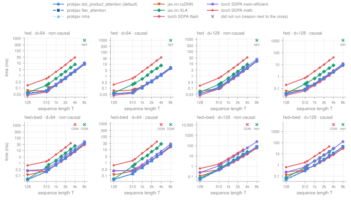
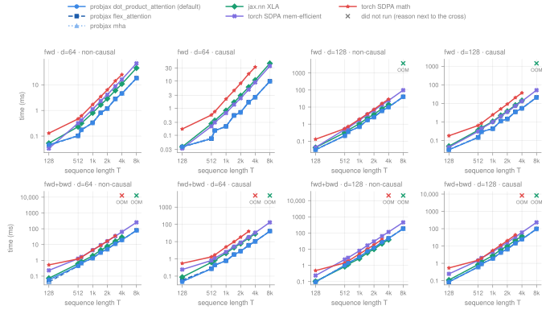
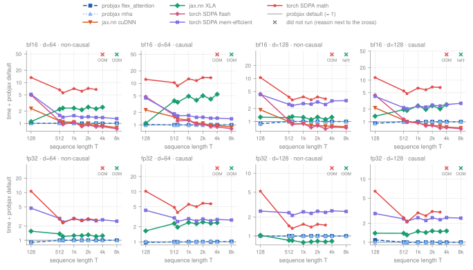
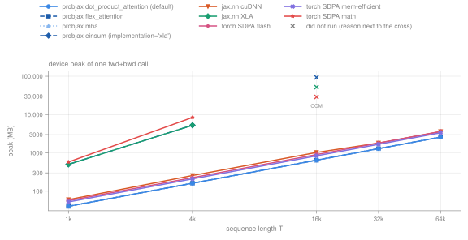
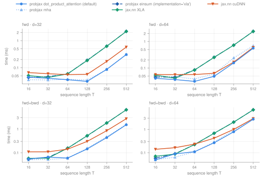
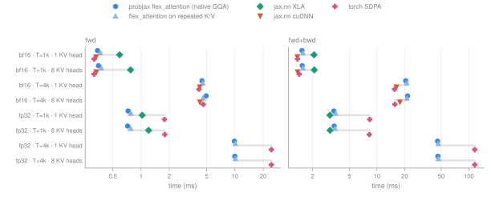
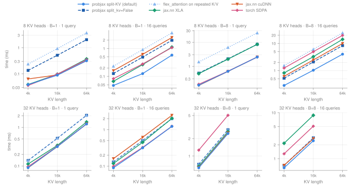
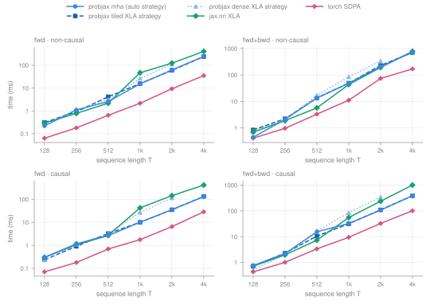
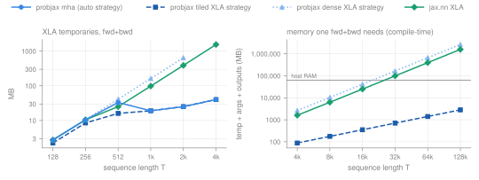

# Attention performance

probjax's attention kernels (`mha`, `flex_attention` and the default `dot_product_attention`, which every probjax transformer uses as `attention_fn`) compared with `jax.nn.dot_product_attention` (XLA and cuDNN backends) and PyTorch `scaled_dot_product_attention` pinned to its flash, memory-efficient and math backends. GPU: NVIDIA GeForce RTX 3090 (24 GB), JAX 0.11.2, torch 2.14.1+cu130. Setup and methodology are on the [overview](gpu_overview.md).

Inputs are `[batch, seq, heads, head_dim]` with batch 4 and 8 heads unless stated otherwise; torch receives the transposed layout it expects. fwd is one forward call; fwd+bwd is the forward plus the gradient with respect to queries, keys and values. Times are medians in milliseconds. OOM: out of device memory. fail†: XLA found no kernel configuration that fits during autotuning (`NOT_FOUND`), so the case did not run. unsup.: the implementation rejects the shape or backend. error: another failure (the JSON row has the message). —: not measured. cuDNN and torch flash have no fp32 path.

## When to use which

- **Default (`dot_product_attention`, `implementation=None`).** On NVIDIA GPUs it runs the fused `flex_attention` kernel whenever that is exact (rules [below](#short-sequences-and-the-default-dispatch)); `flex_attention` and `mha` are the same kernel. Its memory grows linearly in T: fwd+bwd ran up to T = 65,536 (the largest length tried) at batch 4 and 8 heads, dense attention only up to T = 4,096.
- **`jax.nn.dot_product_attention(implementation='cudnn')`** is faster in the bf16 configurations listed under [where an alternative is faster](#where-an-alternative-is-faster); use it there if you need neither probjax masks nor fp32.
- **Dense attention** (`jax.nn` XLA, torch math, probjax `implementation='xla'`) materializes the T × T scores. In this grid `jax.nn` XLA fails from T = 8192 and torch math from T = 4096 (fwd+bwd); it is only competitive for short sequences.
- **Decoding with a KV cache** (few queries, long cache): the default selects the split-KV kernel automatically; see [decoding](#grouped-query-attention-and-decoding).
- **CPU**: probjax runs an XLA formulation whose memory is linear in T; torch's native CPU kernel is faster ([CPU](#cpu)).

## Time



*bf16, batch 4, 8 heads, RTX 3090. Top row forward, bottom row forward + backward; T = 600, 1500 and 3000 test lengths that are not a multiple of the tile size.*



*fp32, batch 4, 8 heads, RTX 3090. fp32 matmuls run in TF32 (JAX default precision).*



*fwd+bwd time of each implementation divided by the probjax default at the same shape; below the line is faster than probjax.*

### Where an alternative is faster

Configurations (T ≥ 512) in which another implementation is more than 5% faster than the probjax default, computed from [`gpu_attention.json`](gpu_attention.json):

- **bf16, head_dim 64, non-causal, forward + backward**: `jax.nn` cuDNN at T = 4096, 8192; torch SDPA flash at T = 2048, 4096, 8192. Largest gap: torch SDPA flash is 1.35× faster at T=8192.
- **bf16, head_dim 64, causal, forward + backward**: `jax.nn` cuDNN at T = 8192; torch SDPA flash at T = 4096, 8192. Largest gap: torch SDPA flash is 1.24× faster at T=8192.
- **bf16, head_dim 128, non-causal, forward + backward**: `jax.nn` cuDNN at T = 1024, 2048, 4096, 8192; torch SDPA flash at T = 1024, 2048, 4096, 8192. Largest gap: torch SDPA flash is 1.40× faster at T=8192.
- **bf16, head_dim 128, causal, forward + backward**: `jax.nn` cuDNN at T = 1024, 2048, 4096, 8192; torch SDPA flash at T = 2048, 4096, 8192. Largest gap: torch SDPA flash is 1.47× faster at T=8192.
- **fp32, head_dim 128, non-causal, forward + backward**: `jax.nn` XLA at T = 512, 1024, 2048, 4096. Largest gap: `jax.nn` XLA is 1.27× faster at T=1024.
- **bf16, head_dim 64, non-causal, forward**: torch SDPA flash at T = 512, 8192. Largest gap: torch SDPA flash is 1.16× faster at T=512.
- **bf16, head_dim 64, causal, forward**: torch SDPA flash at T = 512. Largest gap: torch SDPA flash is 1.07× faster at T=512.
- **bf16, head_dim 128, non-causal, forward**: `jax.nn` cuDNN at T = 4096, 8192; torch SDPA flash at T = 512, 1024, 2048, 4096, 8192. Largest gap: torch SDPA flash is 1.11× faster at T=512.
- **bf16, head_dim 128, causal, forward**: `jax.nn` cuDNN at T = 2048, 4096, 8192; torch SDPA flash at T = 512, 1024, 2048, 4096, 8192. Largest gap: torch SDPA flash is 1.24× faster at T=512.

fwd+bwd at T=4096 in every configuration (ms):

| Implementation | bf16 d64 | bf16 d64 causal | bf16 d128 | bf16 d128 causal | fp32 d64 | fp32 d64 causal | fp32 d128 | fp32 d128 causal |
| --- | ---: | ---: | ---: | ---: | ---: | ---: | ---: | ---: |
| probjax `dot_product_attention` (default) | 9.37 | 5.12 | 20.2 | 11.7 | 23.6 | 11.8 | 46.2 | 24.5 |
| probjax `flex_attention` | 9.34 | 5.13 | 20.2 | 11.7 | 23.7 | 11.9 | 46.3 | 24.5 |
| probjax `mha` | 9.36 | 5.15 | 20.2 | 11.7 | 23.6 | 11.8 | 46.2 | 24.5 |
| `jax.nn` cuDNN | 8.23 | 4.95 | 15.9 | 8.78 | — | — | — | — |
| `jax.nn` XLA | 23.3 | 28.0 | 25.5 | 30.1 | 29.3 | 28.5 | 38.2 | 37.1 |
| torch SDPA flash | 7.78 | 4.57 | 15.1 | 8.50 | — | — | — | — |
| torch SDPA mem-efficient | 13.0 | 7.43 | 61.0 | 30.4 | 63.4 | 32.9 | 116 | 60.4 |
| torch SDPA math | OOM | OOM | OOM | OOM | OOM | OOM | OOM | OOM |

??? note "All 16 configurations as tables"

    **bf16, head_dim 64, non-causal, forward**

    | Implementation | T=128 | T=512 | T=600 | T=1024 | T=1500 | T=2048 | T=3000 | T=4096 | T=8192 |
    | --- | ---: | ---: | ---: | ---: | ---: | ---: | ---: | ---: | ---: |
    | probjax `dot_product_attention` (default) | 0.035 | 0.054 | 0.087 | 0.157 | 0.386 | 0.558 | 1.30 | 2.12 | 8.42 |
    | probjax `flex_attention` | 0.039 | 0.054 | 0.087 | 0.156 | 0.387 | 0.558 | 1.30 | 2.11 | 8.40 |
    | probjax `mha` | 0.035 | 0.054 | 0.092 | 0.162 | 0.396 | 0.568 | 1.31 | 2.12 | 8.45 |
    | `jax.nn` cuDNN | 0.058 | 0.059 | 0.108 | 0.170 | 0.365 | 0.631 | 1.18 | 2.19 | 8.19 |
    | `jax.nn` XLA | 0.041 | 0.160 | 0.218 | 0.562 | 1.16 | 2.05 | 4.42 | 7.84 | fail† |
    | torch SDPA flash | 0.025 | 0.046 | 0.062 | 0.162 | 0.314 | 0.553 | 1.20 | 2.05 | 7.83 |
    | torch SDPA mem-efficient | 0.032 | 0.061 | 0.077 | 0.200 | 0.415 | 0.711 | 1.50 | 2.67 | 10.5 |
    | torch SDPA math | 0.161 | 0.567 | 0.734 | 1.99 | 4.03 | 7.33 | 16.1 | 28.7 | — |

    **bf16, head_dim 64, non-causal, forward + backward**

    | Implementation | T=128 | T=512 | T=600 | T=1024 | T=1500 | T=2048 | T=3000 | T=4096 | T=8192 |
    | --- | ---: | ---: | ---: | ---: | ---: | ---: | ---: | ---: | ---: |
    | probjax `dot_product_attention` (default) | 0.049 | 0.207 | 0.312 | 0.681 | 1.57 | 2.45 | 5.57 | 9.37 | 39.0 |
    | probjax `flex_attention` | 0.049 | 0.207 | 0.313 | 0.681 | 1.57 | 2.46 | 5.59 | 9.34 | 39.1 |
    | probjax `mha` | 0.049 | 0.206 | 0.311 | 0.681 | 1.54 | 2.46 | 5.71 | 9.36 | 39.2 |
    | `jax.nn` cuDNN | 0.113 | 0.237 | 0.339 | 0.732 | 1.41 | 2.37 | 4.89 | 8.23 | 30.7 |
    | `jax.nn` XLA | 0.054 | 0.459 | 0.741 | 1.61 | 3.37 | 6.12 | 12.7 | 23.3 | OOM |
    | torch SDPA flash | 0.241 | 0.234 | 0.295 | 0.728 | 1.32 | 2.25 | 4.61 | 7.78 | 28.8 |
    | torch SDPA mem-efficient | 0.250 | 0.324 | 0.443 | 1.06 | 2.21 | 3.55 | 7.81 | 13.0 | 50.8 |
    | torch SDPA math | 0.643 | 1.37 | 1.74 | 4.83 | 9.63 | 17.6 | 37.8 | OOM | — |

    **bf16, head_dim 64, causal, forward**

    | Implementation | T=128 | T=512 | T=600 | T=1024 | T=1500 | T=2048 | T=3000 | T=4096 | T=8192 |
    | --- | ---: | ---: | ---: | ---: | ---: | ---: | ---: | ---: | ---: |
    | probjax `dot_product_attention` (default) | 0.036 | 0.042 | 0.074 | 0.102 | 0.260 | 0.332 | 0.788 | 1.19 | 4.49 |
    | probjax `flex_attention` | 0.037 | 0.042 | 0.074 | 0.103 | 0.261 | 0.333 | 0.788 | 1.19 | 4.49 |
    | probjax `mha` | 0.035 | 0.042 | 0.077 | 0.109 | 0.261 | 0.342 | 0.829 | 1.21 | 4.54 |
    | `jax.nn` cuDNN | 0.058 | 0.069 | 0.083 | 0.138 | 0.256 | 0.401 | 0.782 | 1.30 | 4.63 |
    | `jax.nn` XLA | 0.040 | 0.206 | 0.264 | 0.593 | 1.20 | 2.38 | 4.40 | 7.84 | fail† |
    | torch SDPA flash | 0.025 | 0.039 | 0.054 | 0.115 | 0.225 | 0.341 | 0.726 | 1.17 | 4.31 |
    | torch SDPA mem-efficient | 0.032 | 0.047 | 0.064 | 0.128 | 0.255 | 0.423 | 0.837 | 1.48 | 5.55 |
    | torch SDPA math | 0.199 | 0.663 | 0.861 | 2.46 | 5.05 | 9.23 | 20.4 | 36.6 | — |

    **bf16, head_dim 64, causal, forward + backward**

    | Implementation | T=128 | T=512 | T=600 | T=1024 | T=1500 | T=2048 | T=3000 | T=4096 | T=8192 |
    | --- | ---: | ---: | ---: | ---: | ---: | ---: | ---: | ---: | ---: |
    | probjax `dot_product_attention` (default) | 0.051 | 0.139 | 0.214 | 0.412 | 0.911 | 1.40 | 3.06 | 5.12 | 19.8 |
    | probjax `flex_attention` | 0.052 | 0.139 | 0.214 | 0.409 | 0.911 | 1.40 | 3.06 | 5.13 | 19.8 |
    | probjax `mha` | 0.050 | 0.139 | 0.213 | 0.412 | 0.923 | 1.40 | 3.14 | 5.15 | 19.8 |
    | `jax.nn` cuDNN | 0.116 | 0.217 | 0.299 | 0.541 | 0.986 | 1.54 | 2.95 | 4.95 | 17.5 |
    | `jax.nn` XLA | 0.055 | 0.529 | 0.751 | 2.02 | 3.57 | 7.05 | 12.8 | 28.0 | OOM |
    | torch SDPA flash | 0.241 | 0.237 | 0.267 | 0.527 | 0.948 | 1.45 | 2.77 | 4.57 | 16.0 |
    | torch SDPA mem-efficient | 0.224 | 0.257 | 0.355 | 0.693 | 1.39 | 2.14 | 4.42 | 7.43 | 27.8 |
    | torch SDPA math | 0.629 | 1.45 | 1.86 | 5.27 | 10.6 | 19.3 | 41.7 | OOM | — |

    **bf16, head_dim 128, non-causal, forward**

    | Implementation | T=128 | T=512 | T=600 | T=1024 | T=1500 | T=2048 | T=3000 | T=4096 | T=8192 |
    | --- | ---: | ---: | ---: | ---: | ---: | ---: | ---: | ---: | ---: |
    | probjax `dot_product_attention` (default) | 0.036 | 0.097 | 0.174 | 0.340 | 0.774 | 1.18 | 2.77 | 4.36 | 16.9 |
    | probjax `flex_attention` | 0.036 | 0.096 | 0.173 | 0.340 | 0.774 | 1.17 | 2.77 | 4.35 | 16.9 |
    | probjax `mha` | 0.036 | 0.108 | 0.186 | 0.367 | 0.845 | 1.20 | 3.00 | 4.72 | 16.8 |
    | `jax.nn` cuDNN | 0.056 | 0.094 | 0.119 | 0.330 | 0.622 | 1.12 | 2.36 | 4.10 | 15.8 |
    | `jax.nn` XLA | 0.047 | 0.198 | 0.271 | 0.650 | 1.38 | 2.34 | 5.07 | 8.86 | fail† |
    | torch SDPA flash | 0.026 | 0.087 | 0.109 | 0.315 | 0.590 | 1.09 | 2.29 | 4.02 | 15.5 |
    | torch SDPA mem-efficient | 0.033 | 0.126 | 0.158 | 0.422 | 0.893 | 1.55 | 3.34 | 5.93 | 23.3 |
    | torch SDPA math | 0.159 | 0.671 | 0.876 | 2.30 | 4.67 | 8.40 | 18.4 | 32.7 | — |

    **bf16, head_dim 128, non-causal, forward + backward**

    | Implementation | T=128 | T=512 | T=600 | T=1024 | T=1500 | T=2048 | T=3000 | T=4096 | T=8192 |
    | --- | ---: | ---: | ---: | ---: | ---: | ---: | ---: | ---: | ---: |
    | probjax `dot_product_attention` (default) | 0.058 | 0.443 | 0.663 | 1.49 | 3.48 | 5.35 | 12.8 | 20.2 | 80.0 |
    | probjax `flex_attention` | 0.052 | 0.443 | 0.663 | 1.50 | 3.48 | 5.38 | 12.8 | 20.2 | 80.0 |
    | probjax `mha` | 0.053 | 0.443 | 0.676 | 1.49 | 3.51 | 5.39 | 12.8 | 20.2 | 80.3 |
    | `jax.nn` cuDNN | 0.109 | 0.441 | 0.587 | 1.32 | 2.82 | 4.36 | 9.97 | 15.9 | 60.7 |
    | `jax.nn` XLA | 0.074 | 0.545 | 0.864 | 1.87 | 3.87 | 6.77 | 14.3 | 25.5 | fail† |
    | torch SDPA flash | 0.253 | 0.462 | 0.571 | 1.34 | 2.53 | 4.28 | 8.66 | 15.1 | 57.4 |
    | torch SDPA mem-efficient | 0.247 | 1.11 | 1.56 | 3.91 | 8.81 | 15.3 | 31.7 | 61.0 | 245 |
    | torch SDPA math | 0.613 | 1.64 | 2.11 | 5.61 | 11.1 | 20.0 | 42.8 | OOM | — |

    **bf16, head_dim 128, causal, forward**

    | Implementation | T=128 | T=512 | T=600 | T=1024 | T=1500 | T=2048 | T=3000 | T=4096 | T=8192 |
    | --- | ---: | ---: | ---: | ---: | ---: | ---: | ---: | ---: | ---: |
    | probjax `dot_product_attention` (default) | 0.038 | 0.078 | 0.162 | 0.218 | 0.558 | 0.699 | 1.73 | 2.47 | 9.32 |
    | probjax `flex_attention` | 0.037 | 0.087 | 0.162 | 0.218 | 0.560 | 0.699 | 1.73 | 2.47 | 9.35 |
    | probjax `mha` | 0.037 | 0.078 | 0.159 | 0.243 | 0.552 | 0.769 | 1.70 | 2.70 | 10.1 |
    | `jax.nn` cuDNN | 0.057 | 0.079 | 0.106 | 0.210 | 0.399 | 0.651 | 1.33 | 2.26 | 8.46 |
    | `jax.nn` XLA | 0.038 | 0.239 | 0.319 | 0.688 | 1.43 | 2.63 | 5.07 | 8.86 | fail† |
    | torch SDPA flash | 0.026 | 0.063 | 0.084 | 0.181 | 0.359 | 0.604 | 1.23 | 2.23 | 8.54 |
    | torch SDPA mem-efficient | 0.032 | 0.083 | 0.116 | 0.254 | 0.513 | 0.862 | 1.77 | 3.17 | 12.1 |
    | torch SDPA math | 0.198 | 0.765 | 1.00 | 2.78 | 5.68 | 10.3 | 22.6 | 40.4 | — |

    **bf16, head_dim 128, causal, forward + backward**

    | Implementation | T=128 | T=512 | T=600 | T=1024 | T=1500 | T=2048 | T=3000 | T=4096 | T=8192 |
    | --- | ---: | ---: | ---: | ---: | ---: | ---: | ---: | ---: | ---: |
    | probjax `dot_product_attention` (default) | 0.055 | 0.311 | 0.467 | 0.937 | 2.05 | 3.17 | 7.00 | 11.7 | 45.0 |
    | probjax `flex_attention` | 0.051 | 0.311 | 0.467 | 0.937 | 2.04 | 3.18 | 7.01 | 11.7 | 45.1 |
    | probjax `mha` | 0.050 | 0.311 | 0.475 | 0.937 | 2.07 | 3.18 | 7.09 | 11.7 | 45.6 |
    | `jax.nn` cuDNN | 0.119 | 0.341 | 0.468 | 0.874 | 1.72 | 2.60 | 5.53 | 8.78 | 32.0 |
    | `jax.nn` XLA | 0.075 | 0.611 | 0.874 | 2.27 | 4.05 | 7.66 | 14.3 | 30.1 | fail† |
    | torch SDPA flash | 0.240 | 0.357 | 0.462 | 0.897 | 1.63 | 2.59 | 4.96 | 8.50 | 30.6 |
    | torch SDPA mem-efficient | 0.226 | 0.681 | 0.959 | 2.21 | 4.63 | 7.97 | 16.8 | 30.4 | 125 |
    | torch SDPA math | 0.639 | 1.72 | 2.22 | 6.04 | 12.0 | 21.7 | 46.7 | OOM | — |

    **fp32, head_dim 64, non-causal, forward**

    | Implementation | T=128 | T=512 | T=600 | T=1024 | T=1500 | T=2048 | T=3000 | T=4096 | T=8192 |
    | --- | ---: | ---: | ---: | ---: | ---: | ---: | ---: | ---: | ---: |
    | probjax `dot_product_attention` (default) | 0.042 | 0.102 | 0.175 | 0.328 | 0.803 | 1.19 | 2.81 | 4.56 | 18.2 |
    | probjax `flex_attention` | 0.036 | 0.101 | 0.175 | 0.328 | 0.809 | 1.19 | 2.80 | 4.53 | 18.0 |
    | probjax `mha` | 0.036 | 0.107 | 0.174 | 0.331 | 0.801 | 1.18 | 2.80 | 4.55 | 18.1 |
    | `jax.nn` cuDNN | — | — | — | — | — | — | — | — | — |
    | `jax.nn` XLA | 0.037 | 0.231 | 0.317 | 0.794 | 1.63 | 2.85 | 5.98 | 10.8 | fail† |
    | torch SDPA flash | — | — | — | — | — | — | — | — | — |
    | torch SDPA mem-efficient | 0.033 | 0.320 | 0.417 | 1.12 | 2.34 | 4.09 | 8.74 | 16.1 | 68.3 |
    | torch SDPA math | 0.129 | 0.469 | 0.612 | 1.69 | 3.46 | 6.32 | 14.2 | 24.8 | — |

    **fp32, head_dim 64, non-causal, forward + backward**

    | Implementation | T=128 | T=512 | T=600 | T=1024 | T=1500 | T=2048 | T=3000 | T=4096 | T=8192 |
    | --- | ---: | ---: | ---: | ---: | ---: | ---: | ---: | ---: | ---: |
    | probjax `dot_product_attention` (default) | 0.047 | 0.445 | 0.681 | 1.55 | 3.50 | 5.87 | 13.4 | 23.6 | 101 |
    | probjax `flex_attention` | 0.043 | 0.444 | 0.681 | 1.55 | 3.49 | 5.87 | 13.3 | 23.7 | 101 |
    | probjax `mha` | 0.043 | 0.444 | 0.695 | 1.55 | 3.53 | 5.85 | 13.5 | 23.6 | 101 |
    | `jax.nn` cuDNN | — | — | — | — | — | — | — | — | — |
    | `jax.nn` XLA | 0.073 | 0.606 | 0.820 | 1.94 | 4.38 | 7.64 | 16.2 | 29.3 | OOM |
    | torch SDPA flash | — | — | — | — | — | — | — | — | — |
    | torch SDPA mem-efficient | 0.222 | 1.27 | 1.64 | 4.39 | 9.20 | 16.1 | 34.3 | 63.4 | 254 |
    | torch SDPA math | 0.504 | 1.23 | 1.58 | 4.48 | 8.97 | 16.5 | 35.7 | OOM | — |

    **fp32, head_dim 64, causal, forward**

    | Implementation | T=128 | T=512 | T=600 | T=1024 | T=1500 | T=2048 | T=3000 | T=4096 | T=8192 |
    | --- | ---: | ---: | ---: | ---: | ---: | ---: | ---: | ---: | ---: |
    | probjax `dot_product_attention` (default) | 0.039 | 0.075 | 0.149 | 0.213 | 0.541 | 0.702 | 1.66 | 2.55 | 9.75 |
    | probjax `flex_attention` | 0.040 | 0.075 | 0.149 | 0.213 | 0.539 | 0.702 | 1.66 | 2.55 | 9.76 |
    | probjax `mha` | 0.037 | 0.082 | 0.147 | 0.213 | 0.532 | 0.710 | 1.69 | 2.55 | 9.76 |
    | `jax.nn` cuDNN | — | — | — | — | — | — | — | — | — |
    | `jax.nn` XLA | 0.039 | 0.265 | 0.352 | 0.815 | 1.63 | 2.89 | 5.99 | 10.9 | fail† |
    | torch SDPA flash | — | — | — | — | — | — | — | — | — |
    | torch SDPA mem-efficient | 0.033 | 0.213 | 0.297 | 0.661 | 1.35 | 2.33 | 4.85 | 8.90 | 35.7 |
    | torch SDPA math | 0.168 | 0.562 | 0.740 | 2.17 | 4.46 | 8.19 | 18.3 | 32.7 | — |

    **fp32, head_dim 64, causal, forward + backward**

    | Implementation | T=128 | T=512 | T=600 | T=1024 | T=1500 | T=2048 | T=3000 | T=4096 | T=8192 |
    | --- | ---: | ---: | ---: | ---: | ---: | ---: | ---: | ---: | ---: |
    | probjax `dot_product_attention` (default) | 0.052 | 0.268 | 0.439 | 0.873 | 1.97 | 3.08 | 6.88 | 11.8 | 48.2 |
    | probjax `flex_attention` | 0.051 | 0.268 | 0.436 | 0.873 | 1.96 | 3.09 | 6.92 | 11.9 | 48.9 |
    | probjax `mha` | 0.054 | 0.269 | 0.447 | 0.873 | 2.00 | 3.09 | 7.18 | 11.8 | 48.8 |
    | `jax.nn` cuDNN | — | — | — | — | — | — | — | — | — |
    | `jax.nn` XLA | 0.087 | 0.625 | 0.860 | 2.13 | 4.53 | 7.64 | 16.2 | 28.5 | OOM |
    | torch SDPA flash | — | — | — | — | — | — | — | — | — |
    | torch SDPA mem-efficient | 0.223 | 0.805 | 1.12 | 2.52 | 5.12 | 8.80 | 18.1 | 32.9 | 131 |
    | torch SDPA math | 0.537 | 1.31 | 1.69 | 4.90 | 9.87 | 18.2 | 39.5 | OOM | — |

    **fp32, head_dim 128, non-causal, forward**

    | Implementation | T=128 | T=512 | T=600 | T=1024 | T=1500 | T=2048 | T=3000 | T=4096 | T=8192 |
    | --- | ---: | ---: | ---: | ---: | ---: | ---: | ---: | ---: | ---: |
    | probjax `dot_product_attention` (default) | 0.037 | 0.209 | 0.360 | 0.704 | 1.72 | 2.58 | 6.01 | 9.95 | 39.4 |
    | probjax `flex_attention` | 0.033 | 0.209 | 0.362 | 0.704 | 1.72 | 2.58 | 6.01 | 9.94 | 39.7 |
    | probjax `mha` | 0.040 | 0.226 | 0.359 | 0.704 | 1.72 | 2.71 | 6.11 | 9.96 | 41.1 |
    | `jax.nn` cuDNN | — | — | — | — | — | — | — | — | — |
    | `jax.nn` XLA | 0.049 | 0.322 | 0.451 | 1.05 | 2.28 | 3.78 | 8.11 | 14.4 | fail† |
    | torch SDPA flash | — | — | — | — | — | — | — | — | — |
    | torch SDPA mem-efficient | 0.044 | 0.490 | 0.608 | 1.70 | 3.62 | 6.37 | 13.7 | 24.4 | 98.2 |
    | torch SDPA math | 0.132 | 0.547 | 0.721 | 1.96 | 4.01 | 7.28 | 16.2 | 28.9 | — |

    **fp32, head_dim 128, non-causal, forward + backward**

    | Implementation | T=128 | T=512 | T=600 | T=1024 | T=1500 | T=2048 | T=3000 | T=4096 | T=8192 |
    | --- | ---: | ---: | ---: | ---: | ---: | ---: | ---: | ---: | ---: |
    | probjax `dot_product_attention` (default) | 0.095 | 0.986 | 1.40 | 3.30 | 7.39 | 12.1 | 27.0 | 46.2 | 185 |
    | probjax `flex_attention` | 0.095 | 0.987 | 1.39 | 3.29 | 7.40 | 12.1 | 26.9 | 46.3 | 185 |
    | probjax `mha` | 0.095 | 0.986 | 1.42 | 3.29 | 7.46 | 12.1 | 27.2 | 46.2 | 185 |
    | `jax.nn` cuDNN | — | — | — | — | — | — | — | — | — |
    | `jax.nn` XLA | 0.098 | 0.841 | 1.18 | 2.61 | 5.99 | 10.0 | 21.9 | 38.2 | OOM |
    | torch SDPA flash | — | — | — | — | — | — | — | — | — |
    | torch SDPA mem-efficient | 0.238 | 2.32 | 2.97 | 8.02 | 17.0 | 30.0 | 64.1 | 116 | 456 |
    | torch SDPA math | 0.494 | 1.43 | 1.84 | 5.10 | 10.3 | 18.6 | 40.3 | OOM | — |

    **fp32, head_dim 128, causal, forward**

    | Implementation | T=128 | T=512 | T=600 | T=1024 | T=1500 | T=2048 | T=3000 | T=4096 | T=8192 |
    | --- | ---: | ---: | ---: | ---: | ---: | ---: | ---: | ---: | ---: |
    | probjax `dot_product_attention` (default) | 0.032 | 0.146 | 0.297 | 0.429 | 1.10 | 1.44 | 3.45 | 5.35 | 20.7 |
    | probjax `flex_attention` | 0.032 | 0.146 | 0.297 | 0.427 | 1.10 | 1.44 | 3.46 | 5.33 | 20.6 |
    | probjax `mha` | 0.035 | 0.146 | 0.296 | 0.425 | 1.10 | 1.53 | 3.56 | 5.53 | 20.9 |
    | `jax.nn` cuDNN | — | — | — | — | — | — | — | — | — |
    | `jax.nn` XLA | 0.049 | 0.356 | 0.485 | 1.06 | 2.26 | 3.79 | 8.04 | 14.3 | fail† |
    | torch SDPA flash | — | — | — | — | — | — | — | — | — |
    | torch SDPA mem-efficient | 0.043 | 0.308 | 0.444 | 0.989 | 2.03 | 3.49 | 7.25 | 13.1 | 51.5 |
    | torch SDPA math | 0.168 | 0.639 | 0.846 | 2.41 | 5.01 | 9.12 | 20.3 | 36.6 | — |

    **fp32, head_dim 128, causal, forward + backward**

    | Implementation | T=128 | T=512 | T=600 | T=1024 | T=1500 | T=2048 | T=3000 | T=4096 | T=8192 |
    | --- | ---: | ---: | ---: | ---: | ---: | ---: | ---: | ---: | ---: |
    | probjax `dot_product_attention` (default) | 0.084 | 0.617 | 0.937 | 1.88 | 4.24 | 6.57 | 14.6 | 24.5 | 96.7 |
    | probjax `flex_attention` | 0.092 | 0.618 | 0.937 | 1.88 | 4.25 | 6.54 | 14.6 | 24.5 | 97.0 |
    | probjax `mha` | 0.084 | 0.618 | 0.958 | 1.88 | 4.30 | 6.56 | 14.9 | 24.5 | 96.5 |
    | `jax.nn` cuDNN | — | — | — | — | — | — | — | — | — |
    | `jax.nn` XLA | 0.117 | 0.856 | 1.22 | 2.80 | 6.05 | 9.93 | 21.7 | 37.1 | OOM |
    | torch SDPA flash | — | — | — | — | — | — | — | — | — |
    | torch SDPA mem-efficient | 0.240 | 1.45 | 2.01 | 4.61 | 9.39 | 16.1 | 33.4 | 60.4 | 233 |
    | torch SDPA math | 0.542 | 1.51 | 1.96 | 5.52 | 11.1 | 20.2 | 44.0 | OOM | — |

## Memory



*True device peak of one fwd+bwd call, bf16, head_dim 64, batch 4, 8 heads, non-causal, read in a fresh process, RTX 3090.*

Largest power-of-two T whose fwd+bwd ran (the search stopped at 65,536, so that value means *at least*):

| Implementation | largest T |
| --- | ---: |
| probjax `dot_product_attention` (default) | 65,536 |
| probjax einsum (`implementation='xla'`) | 4,096 |
| `jax.nn` XLA | 4,096 |
| `jax.nn` cuDNN | 65,536 |
| torch SDPA flash | 65,536 |
| torch SDPA mem-efficient | 65,536 |
| torch SDPA math | 4,096 |

Bytes kept for the backward pass (`jax.vjp` residuals, MB), batch 2, 8 heads, head_dim 64 ([`kernel_attn_gpu_residuals.json`](kernel_attn_gpu_residuals.json)). The kernels keep the output and the log-sum-exp; dense paths keep the T × T probabilities:

| Implementation | bf16 T=1000 | bf16 T=2048 | fp32 T=1000 | fp32 T=2048 |
| --- | ---: | ---: | ---: | ---: |
| probjax `dot_product_attention` (default) | 8.06 | 16.1 | 16.1 | 32.1 |
| probjax `mha` | 8.06 | 16.1 | 16.1 | 32.1 |
| probjax einsum (`implementation='xla'`) | 97.5 | 396 | 134 | 536 |
| `jax.nn` XLA | 97.5 | 396 | 134 | 536 |
| `jax.nn` cuDNN | 7.87 | 16.1 | — | — |

## Short sequences and the default dispatch

`probjax.nn.layers.attention.dot_product_attention` is the default `attention_fn` of `Transformer`, `DiffusionTransformer` and the attention conditioners. With `implementation=None` it runs the fused kernel (`flex_attention`) on NVIDIA GPUs when that is exact:

- no mask, or a position-only mask (causal, length or window masks); no dense boolean mask,
- no additive bias, no dropout, default `precision`,
- at least 64 keys.

Otherwise, and on CPU, it uses the Flax einsum. `implementation='xla'` forces the einsum and `implementation='pallas'` the kernel. GQA inputs (fewer KV heads than query heads) also go to the kernel.



*bf16, batch 64, 8 heads, non-causal, RTX 3090 ([`kernel_attn_gpu_dispatch.json`](kernel_attn_gpu_dispatch.json)).*

In this sweep the `mha` kernel is more than 5% faster than the einsum in fwd+bwd at every swept length for head_dim 32 and 64. The default switches to the kernel from 64 keys on. cuDNN pays a fixed launch cost at short lengths.

### Tile selection

With default block sizes, `mha` picks tiles from a shared-memory model and a tuned table per (dtype, head_dim). Auto choice against the best of every forced (block, stages, warps) combination, batch 4, 8 heads ([`gpu_attention_tiles.json`](gpu_attention_tiles.json)); the last column counts configurations that ran and those Triton rejected for exceeding shared memory:

| dtype | head_dim | T | mode | auto (ms) | best forced (ms) | best forced config | ran / rejected |
| --- | ---: | ---: | ---: | ---: | ---: | ---: | ---: |
| bf16 | 64 | 2048 | fwd | 0.568 | 0.558 | q64/k64, 2 st, 4 w | 54 / 0 |
| bf16 | 64 | 2048 | fwd+bwd | 2.44 | 2.46 | fwd q64/k64, bwd 64/64, 2 st, 4 w | 48 / 0 |
| bf16 | 64 | 8192 | fwd | 8.46 | 7.98 | q128/k64, 2 st, 4 w | 54 / 0 |
| bf16 | 64 | 8192 | fwd+bwd | 38.9 | 39.6 | fwd q64/k64, bwd 64/64, 2 st, 4 w | 48 / 0 |
| bf16 | 128 | 2048 | fwd | 1.28 | 1.14 | q128/k32, 1 st, 4 w | 38 / 16 |
| bf16 | 128 | 2048 | fwd+bwd | 5.34 | 5.41 | fwd q128/k64, bwd 64/32, 2 st, 4 w | 36 / 12 |
| bf16 | 128 | 8192 | fwd | 16.7 | 15.9 | q128/k32, 1 st, 4 w | 38 / 16 |
| bf16 | 128 | 8192 | fwd+bwd | 79.6 | 80.3 | fwd q128/k64, bwd 64/32, 2 st, 4 w | 36 / 12 |
| fp32 | 64 | 2048 | fwd | 1.18 | 1.18 | q128/k64, 1 st, 4 w | 40 / 14 |
| fp32 | 64 | 2048 | fwd+bwd | 5.86 | 5.75 | fwd q64/k32, bwd 32/32, 2 st, 4 w | 44 / 4 |
| fp32 | 64 | 8192 | fwd | 18.0 | 16.7 | q128/k64, 1 st, 4 w | 40 / 14 |
| fp32 | 64 | 8192 | fwd+bwd | 101 | 99.9 | fwd q64/k32, bwd 32/32, 2 st, 4 w | 44 / 4 |
| fp32 | 128 | 2048 | fwd | 2.71 | 2.58 | q64/k32, 1 st, 4 w | 22 / 32 |
| fp32 | 128 | 2048 | fwd+bwd | 12.1 | 12.1 | fwd q64/k32, bwd 64/32, 1 st, 4 w | 20 / 28 |
| fp32 | 128 | 8192 | fwd | 39.7 | 38.1 | q128/k32, 1 st, 8 w | 22 / 32 |
| fp32 | 128 | 8192 | fwd+bwd | 185 | 186 | fwd q64/k32, bwd 64/32, 1 st, 4 w | 20 / 28 |

## Grouped-query attention and decoding

The kernels read KV head `h // G` directly instead of repeating K and V in memory (`flex_attention` and `dot_product_attention` route GQA inputs to them).



*32 query heads, head_dim 128, batch 1, Lq = Lkv = T, median of three rounds, RTX 3090 ([`kernel_attn_ext_gpu.json`](kernel_attn_ext_gpu.json), suite `gqa`).*

Memory of native GQA against running the kernel on repeated K/V (MB):

| dtype | T | KV heads | fwd temp, native | fwd temp, repeated K/V | bwd residuals, native | bwd residuals, repeated K/V |
| --- | ---: | ---: | ---: | ---: | ---: | ---: |
| bf16 | 1024 | 1 | 0 | 16.0 | 8.13 | 24.1 |
| bf16 | 1024 | 8 | 0 | 16.0 | 8.13 | 24.1 |
| bf16 | 4096 | 1 | 0 | 64.0 | 32.5 | 96.5 |
| bf16 | 4096 | 8 | 0 | 64.0 | 32.5 | 96.5 |
| fp32 | 1024 | 1 | 0 | 32.0 | 16.1 | 48.1 |
| fp32 | 1024 | 8 | 0 | 32.0 | 16.1 | 48.1 |
| fp32 | 4096 | 1 | 0 | 128 | 64.5 | 193 |
| fp32 | 4096 | 8 | 0 | 128 | 64.5 | 193 |

**Split-KV decoding.** For few queries against a long KV cache the regular kernel parallelizes only over batch × heads × query tiles. The split-KV forward splits the keys across programs, packs the query heads of a GQA group into one tile and combines the partial results with their log-sum-exp. It is selected automatically for unmasked inputs with Lq ≤ 64, Lkv ≥ 1024 and at least two splits; `split_kv=False` disables it. Under `jax.grad` the regular kernel runs.



*bf16, 32 query heads, head_dim 128, median of three rounds, RTX 3090. Top row GQA with 8 KV heads, bottom row 32 KV heads (plain multi-head; batch 8 at 64k keys was not run).*

??? note "Decoding tables (bf16 Lq = 1, 4, 16; fp32 head_dim 64)"

    bf16, head_dim 128, 8 KV heads:

    | B | Lq | Lkv | probjax split-KV (default) | probjax `split_kv=False` | `flex_attention` on repeated K/V | `jax.nn` XLA | `jax.nn` cuDNN | torch SDPA |
    | --- | ---: | ---: | ---: | ---: | ---: | ---: | ---: | ---: |
    | 1 | 1 | 4k | 0.039 | 0.136 | 0.237 | 0.039 | 0.064 | 0.036 |
    | 1 | 1 | 16k | 0.089 | 0.515 | 0.924 | 0.097 | 0.091 | 0.097 |
    | 1 | 1 | 64k | 0.318 | 2.03 | 3.68 | 0.372 | 0.318 | 0.348 |
    | 1 | 4 | 4k | 0.041 | 0.136 | 0.237 | 0.044 | 0.160 | 0.082 |
    | 1 | 4 | 16k | 0.089 | 0.514 | 0.924 | 0.168 | 0.619 | 0.278 |
    | 1 | 4 | 64k | 0.319 | 2.03 | 3.67 | 0.520 | 2.46 | 1.07 |
    | 1 | 16 | 4k | 0.047 | 0.127 | 0.233 | 0.067 | 0.160 | 0.083 |
    | 1 | 16 | 16k | 0.126 | 0.490 | 0.905 | 0.265 | 0.619 | 0.279 |
    | 1 | 16 | 64k | 0.579 | 1.96 | 3.61 | 1.12 | 2.47 | 1.08 |
    | 8 | 1 | 4k | 0.165 | 0.522 | 1.53 | 0.497 | 0.161 | 0.180 |
    | 8 | 1 | 16k | 0.622 | 2.05 | 6.07 | 1.99 | 0.617 | 0.629 |
    | 8 | 1 | 64k | 2.43 | 8.23 | 24.4 | 8.19 | 2.44 | 2.45 |
    | 8 | 4 | 4k | 0.168 | 0.524 | 1.53 | 0.576 | 0.606 | 1.22 |
    | 8 | 4 | 16k | 0.622 | 2.07 | 6.09 | 2.42 | 2.44 | 4.92 |
    | 8 | 4 | 64k | 2.44 | 8.33 | 24.4 | 9.35 | 9.89 | 19.8 |
    | 8 | 16 | 4k | 0.282 | 0.521 | 1.53 | 0.817 | 0.612 | 1.24 |
    | 8 | 16 | 16k | 1.03 | 2.08 | 6.10 | 3.24 | 2.46 | 4.95 |
    | 8 | 16 | 64k | 4.02 | 8.32 | 24.4 | 14.2 | 9.99 | 19.8 |

    bf16, head_dim 128, 32 KV heads:

    | B | Lq | Lkv | probjax split-KV (default) | probjax `split_kv=False` | `flex_attention` on repeated K/V | `jax.nn` XLA | `jax.nn` cuDNN | torch SDPA |
    | --- | ---: | ---: | ---: | ---: | ---: | ---: | ---: | ---: |
    | 1 | 1 | 4k | 0.090 | 0.139 | 0.139 | 0.113 | 0.090 | 0.096 |
    | 1 | 1 | 16k | 0.319 | 0.523 | 0.523 | 0.342 | 0.318 | 0.323 |
    | 1 | 1 | 64k | 1.23 | 2.07 | 2.06 | 1.39 | 1.24 | 1.23 |
    | 1 | 16 | 4k | 0.090 | 0.130 | 0.130 | 0.118 | 0.161 | 0.099 |
    | 1 | 16 | 16k | 0.317 | 0.502 | 0.502 | 0.450 | 0.619 | 0.326 |
    | 1 | 16 | 64k | 1.23 | 1.99 | 1.99 | 2.04 | 2.47 | 1.24 |
    | 8 | 1 | 4k | 0.627 | 0.722 | 0.722 | 0.668 | 0.637 | 1.27 |
    | 8 | 1 | 16k | 2.45 | 2.85 | 2.85 | 2.64 | 2.52 | 5.05 |
    | 8 | 1 | 64k | — | — | — | — | — | — |
    | 8 | 16 | 4k | 0.633 | 0.716 | 0.715 | 2.16 | 0.719 | 1.28 |
    | 8 | 16 | 16k | 2.45 | 2.85 | 2.85 | 8.78 | 2.72 | 5.08 |
    | 8 | 16 | 64k | — | — | — | — | — | — |

    fp32, head_dim 64, 8 KV heads:

    | B | Lq | Lkv | probjax split-KV (default) | probjax `split_kv=False` | `flex_attention` on repeated K/V | `jax.nn` XLA | `jax.nn` cuDNN | torch SDPA |
    | --- | ---: | ---: | ---: | ---: | ---: | ---: | ---: | ---: |
    | 1 | 1 | 4k | 0.040 | 0.206 | — | 0.041 | — | 0.683 |
    | 1 | 1 | 16k | 0.088 | 0.794 | — | 0.099 | — | 2.70 |
    | 1 | 1 | 64k | 0.318 | 3.19 | — | 0.381 | — | 10.9 |
    | 1 | 4 | 4k | 0.037 | 0.212 | — | 0.045 | — | 0.683 |
    | 1 | 4 | 16k | 0.088 | 0.822 | — | 0.180 | — | 2.71 |
    | 1 | 4 | 64k | 0.318 | 3.26 | — | 0.558 | — | 10.8 |
    | 1 | 16 | 4k | 0.042 | 0.198 | — | 0.089 | — | 0.686 |
    | 1 | 16 | 16k | 0.108 | 0.773 | — | 0.342 | — | 2.70 |
    | 1 | 16 | 64k | 0.485 | 3.11 | — | 1.28 | — | 10.9 |

Device peak at batch 8, 64k keys, 8 KV heads, bf16 (fresh process):

| Lq | Implementation | peak (MB) | inputs incl. KV cache (MB) |
| --- | --- | ---: | ---: |
| 1 | probjax split-KV (default) | 2,050 | 2,048 |
| 1 | probjax `split_kv=False` | 2,050 | 2,048 |
| 1 | `flex_attention` on repeated K/V | 10,242 | 2,048 |
| 1 | torch SDPA | 2,049 | 2,048 |
| 16 | probjax split-KV (default) | 2,089 | 2,054 |
| 16 | probjax `split_kv=False` | 2,055 | 2,054 |
| 16 | `flex_attention` on repeated K/V | 10,247 | 2,054 |
| 16 | torch SDPA | 2,052 | 2,051 |

## CPU

On CPU, `mha`, `mla` and `flex_attention` run an XLA formulation: dense for T ≤ 256, a single-tile flash `custom_vjp` up to 512, and 256 × 256 tiles with block-mask tile skipping above that; the backward recomputes from the log-sum-exp. Masks, biases (with gradients), dropout, GQA without repeating K/V and forward-mode AD are supported. The default `dot_product_attention` uses the Flax einsum on CPU.



*fp32, batch 1, 8 heads, head_dim 64, shared 24-thread host (10–30% run-to-run noise) ([`kernel_attn-cpu_cpu.json`](kernel_attn-cpu_cpu.json)).*



*Left: XLA temporaries of the non-causal fwd+bwd. Right: compile-time memory (temporaries + arguments + outputs) one fwd+bwd needs, against the host's RAM ([`kernel_attn-cpu_cpu_memory.json`](kernel_attn-cpu_cpu_memory.json)).*

At T=4096 (non-causal fwd+bwd) the probjax default takes 721 ms, `jax.nn` XLA 779 ms and torch 169 ms; torch's native CPU kernel is the fastest option on CPU.

CPU decoding, fp32, 32 query heads, 8 KV heads, head_dim 128, batch 1 ([`kernel_attn_ext_cpu.json`](kernel_attn_ext_cpu.json)), ms:

| Lq | Lkv | probjax `flex_attention` | `flex_attention` on repeated K/V | `jax.nn` XLA | torch SDPA |
| --- | ---: | ---: | ---: | ---: | ---: |
| 1 | 4k | 9.73 | 55.5 | 9.28 | 0.700 |
| 1 | 16k | 42.5 | 222 | 40.4 | 13.4 |
| 1 | 64k | 168 | 1,515 | 165 | 69.0 |
| 16 | 4k | 15.9 | 58.6 | 15.3 | 2.20 |
| 16 | 16k | 64.7 | 241 | 62.8 | 16.4 |
| 16 | 64k | 379 | 1,121 | 250 | 69.6 |

## How to reproduce

```bash
# Cross-library grid and the tile sweep (CUDA GPU; torch optional).
python -m docs.scripts.benchmark_gpu_attention --output docs/benchmarks/gpu_attention.json
python -m docs.scripts.benchmark_gpu_attention_tiles --output docs/benchmarks/gpu_attention_tiles.json

# Short-sequence sweep, device peak and residuals.
python -m docs.scripts.benchmark_kernel_attn_gpu --device gpu --suite dispatch \
  --output docs/benchmarks/kernel_attn_gpu_dispatch.json
python -m docs.scripts.benchmark_kernel_attn_gpu --device gpu --suite peak \
  --output docs/benchmarks/kernel_attn_gpu_memory.json

# GQA and split-KV decoding.
python -m docs.scripts.benchmark_kernel_attn_ext --device gpu --suite gqa \
  --output docs/benchmarks/kernel_attn_ext_gpu.json
python -m docs.scripts.benchmark_kernel_attn_ext --device gpu --suite decode \
  --output docs/benchmarks/kernel_attn_ext_gpu.json --append

# CPU.
JAX_PLATFORMS=cpu python -m docs.scripts.benchmark_kernel_attn-cpu \
  --device cpu --output docs/benchmarks/kernel_attn-cpu_cpu.json

# Rebuild the figures and this page from the JSON.
python -m docs.scripts.benchmark_figures
```
