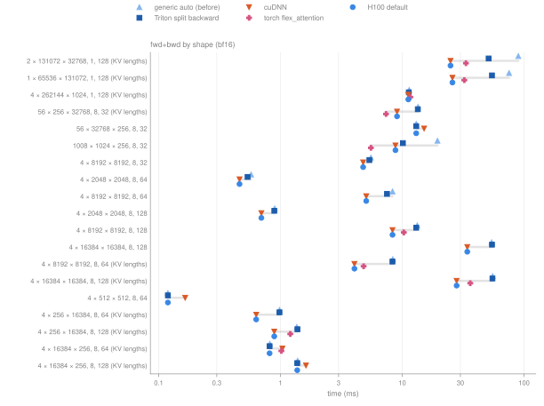
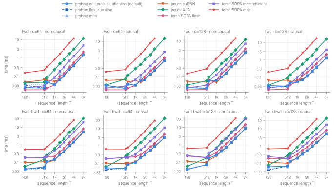
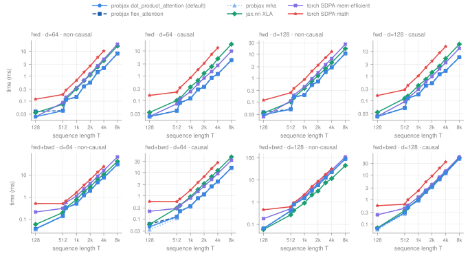
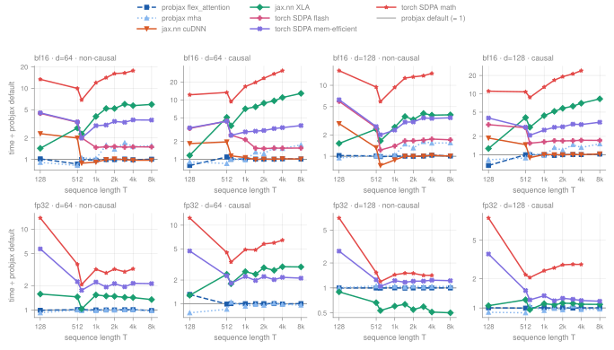
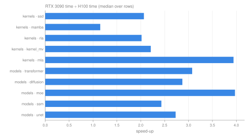
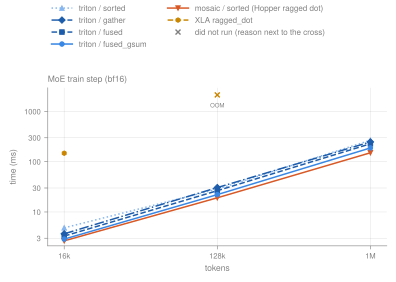

# H100 (Hopper)

The same suites as on the [RTX 3090 pages](gpu_overview.md), run on an NVIDIA H100, plus the measurements behind the device-specific defaults for Hopper. Times are medians in milliseconds; inputs are `[batch, seq, heads, head_dim]` and bf16 unless stated otherwise. OOM: out of device memory. fail†: XLA found no kernel configuration that fits during autotuning (`NOT_FOUND`), so the case did not run. unsup.: the implementation rejects the shape or backend. error: another failure (the JSON row has the message). —: not measured.

## Setup

|  |  |
| --- | --- |
| GPU | NVIDIA H100 NVL, 94 GB (sm_90, 227 KB opt-in shared memory per block) |
| Software | JAX 0.11.2, cuDNN 9.27, CUDA 13.4 (pip wheels), Python 3.13; PyTorch 2.14.1+cu130 for the torch rows |
| PyTorch rows | measured in a separate process with JAX's GPU preallocation off (`XLA_PYTHON_CLIENT_PREALLOCATE=false`, platform allocator), so torch has the whole GPU; JAX only builds the inputs and the reference |
| Results | [`gpu_attention_h100.json`](gpu_attention_h100.json), [`gpu_attention_tiles_h100.json`](gpu_attention_tiles_h100.json), [`gpu_kernels_h100.json`](gpu_kernels_h100.json), [`gpu_nn_h100.json`](gpu_nn_h100.json) (the suites of the RTX 3090 pages), [`gpu_attention_h100_device.json`](gpu_attention_h100_device.json) (`docs/scripts/benchmark_gpu_attention_device.py`), [`gpu_moe_h100.json`](gpu_moe_h100.json) (`docs/scripts/benchmark_gpu_moe_dispatch.py`) |

## Device-specific defaults

`flex_attention` and `dot_product_attention` look up the GPU's compute capability in `probjax.nn.layers.attention_device` when every kernel argument is at its default. GPUs without an entry (RTX 3090 and other non-sm_90 devices) keep the generic rules. On sm_90:

| Case | Kernel |
| --- | --- |
| bf16/fp16; no mask, `KVLenMask` or causal with Lq = Lkv; no bias or dropout; head_dim a multiple of 8, ≤ 128; B·H·Lq·Lkv ≥ 2^26 (head_dim ≥ 64) or 2^30 (head_dim 32) | cuDNN (`jax.nn.dot_product_attention(implementation="cudnn")`) |
| …except Lkv ≤ 256 with Lq ≥ 16·Lkv, and Lq ≤ 64 with Lkv ≥ 16·Lq | Triton (faster there) |
| Everything else, `backward_pass_impl="auto"` | Triton split backward; single-pass for 16-bit Lq ≤ 256, Lkv ≥ 16·Lq |

`implementation="triton"` (per call), `PROBJAX_ATTENTION_CUDNN=0` or `PROBJAX_ATTENTION_DEVICE_DEFAULTS=0` (generic rules) opt out. The cuDNN path is not bitwise identical to the Triton kernels; outputs and gradients agree to bf16 precision (max |difference| ≤ 0.004 in `tests/test_attention_device_defaults.py`).

### Why

The generic `auto` rule picks the fused backward whenever the two lengths differ by at most 4×; on H100 that is up to 1.92× slower than the split backward, which is never more than 1% slower than `auto`. cuDNN, which supports per-batch KV lengths, is faster than every Triton variant above the work thresholds. fwd+bwd, ms ("generic `auto`" is the dispatch before the sm_90 entry):

*fwd+bwd per implementation and shape, bf16; the H100 default is the filled blue dot.*

| B × Lq × Lkv, H, d | generic `auto` | split | single-pass | cuDNN | H100 default | path | speed-up |
| --- | ---: | ---: | ---: | ---: | ---: | --- | ---: |
| 2 × 131072 × 32768, 1, 128 (KV lengths) | 89.7 | 51.2 | 81.0 | 24.9 | **24.9** | cuDNN | 3.60× |
| 1 × 65536 × 131072, 1, 128 (KV lengths) | 75.3 | 54.5 | 79.4 | 25.8 | **25.8** | cuDNN | 2.92× |
| 4 × 262144 × 1024, 1, 128 (KV lengths) | 11.4 | 11.3 | 20.0 | 11.2 | **11.2** | cuDNN | 1.02× |
| 56 × 256 × 32768, 8, 32 (KV lengths) | 13.5 | 13.4 | 12.9 | 9.06 | **9.06** | cuDNN | 1.49× |
| 56 × 32768 × 256, 8, 32 | 13.0 | 13.0 | 19.3 | 15.1 | **13.0** | triton_split | 1.00× |
| 1008 × 1024 × 256, 8, 32 | 19.4 | 10.1 | 11.6 | 8.79 | **8.79** | cuDNN | 2.21× |
| 4 × 8192 × 8192, 8, 32 | 5.53 | 5.37 | 5.91 | 4.77 | **4.77** | cuDNN | 1.16× |
| 4 × 2048 × 2048, 8, 64 | 0.574 | 0.537 | 0.609 | 0.461 | **0.461** | cuDNN | 1.25× |
| 4 × 8192 × 8192, 8, 64 | 8.32 | 7.49 | 8.84 | 5.06 | **5.06** | cuDNN | 1.64× |
| 4 × 2048 × 2048, 8, 128 | 0.896 | 0.890 | 1.45 | 0.697 | **0.697** | cuDNN | 1.29× |
| 4 × 8192 × 8192, 8, 128 | 13.3 | 13.0 | 21.3 | 8.31 | **8.31** | cuDNN | 1.60× |
| 4 × 16384 × 16384, 8, 128 | 54.2 | 54.5 | 83.6 | 34.2 | **34.2** | cuDNN | 1.59× |
| 4 × 8192 × 8192, 8, 64 (KV lengths) | 8.35 | 8.31 | 8.61 | 4.05 | **4.05** | cuDNN | 2.06× |
| 4 × 16384 × 16384, 8, 128 (KV lengths) | 55.2 | 55.0 | 83.7 | 27.9 | **27.9** | cuDNN | 1.98× |
| 4 × 512 × 512, 8, 64 | 0.119 | 0.119 | 0.129 | 0.165 | **0.119** | triton_split | 1.00× |
| 4 × 256 × 16384, 8, 64 (KV lengths) | 0.982 | 0.981 | 0.821 | 0.632 | **0.632** | cuDNN | 1.55× |
| 4 × 256 × 16384, 8, 128 (KV lengths) | 1.36 | 1.38 | 1.65 | 0.889 | **0.889** | cuDNN | 1.53× |
| 4 × 16384 × 256, 8, 64 (KV lengths) | 0.818 | 0.814 | 1.06 | 1.04 | **0.814** | triton_split | 1.00× |
| 4 × 16384 × 256, 8, 128 (KV lengths) | 1.38 | 1.37 | 1.94 | 1.62 | **1.37** | triton_split | 1.01× |

Few queries over long KV, measured with the H100 default:

| B × Lq × Lkv, H, d | generic `auto` | single-pass | cuDNN | H100 default |
| --- | ---: | ---: | ---: | ---: |
| 28 × 256 × 131072, 8, 32 (KV lengths) | 26.7 | 24.3 | 20.1 | **20.0** |
| 56 × 256 × 32768, 8, 32 (KV lengths) | 13.6 | 13.1 | 9.35 | **9.30** |
| 4 × 128 × 262144, 8, 64 (KV lengths) | 12.9 | 9.29 | 6.42 | **6.40** |
| 8 × 64 × 131072, 8, 64 (KV lengths) | 6.91 | 4.51 | 4.81 | **4.85** |
| 16 × 16 × 65536, 8, 128 (KV lengths) | 8.19 | 6.48 | 7.38 | **7.38** |
| 8 × 512 × 131072, 8, 32 (KV lengths) | 13.4 | 12.4 | 10.6 | **10.6** |

## Mosaic GPU

`mha_flash` runs JAX's Hopper FlashAttention-3 kernel (warpgroup MMA, TMA pipelining), vendored as `pallas_kernels/kernels/attention_mgpu.py` because upstream hard-codes float16 shared-memory buffers and rejects every bf16 call. The wrapper takes Lq ≠ Lkv and GQA and pads query length and head_dim exactly; KV lengths that are not a multiple of the KV tile raise (padded keys need an in-kernel length mask). Its default tiles are the best H100 configuration found (64 × 128 forward, backward dK/dV 128 × 64 and dQ 64 × 128, two compute warpgroups); deeper pipelines and 128 × 128 tiles with two warpgroups exceed shared memory at head_dim 128. Unmasked, fwd+bwd ms:

| B × Lq × Lkv, H, d | 128 × 128 tiles (old default) | tuned (default) | cuDNN | Triton split |
| --- | ---: | ---: | ---: | ---: |
| 4 × 8192 × 8192, 8, 64 | 9.67 | **5.40** | 5.01 | 8.03 |
| 4 × 8192 × 8192, 8, 128 | 39.2 | **9.52** | 8.28 | 12.8 |
| 2 × 131072 × 32768, 1, 128 | 137 | **37.4** | 32.8 | 50.6 |

The forward matches cuDNN; the backward is 8–17% slower, so it is not used by default. For masks and biases cuDNN cannot express, which run on Triton, a masked Mosaic kernel would be about 1.3–1.5× faster than Triton (follow-up).

## Attention suite

*bf16, batch 4, 8 heads, H100. Top row forward, bottom row forward + backward.*

*fp32, batch 4, 8 heads, H100. fp32 matmuls run in TF32 (JAX default precision).*

*fwd+bwd time of each implementation divided by the probjax default at the same shape; below the line is faster than probjax.*

| fwd+bwd, B = 4, H = 8 | probjax default | `jax.nn` cuDNN | `jax.nn` XLA | torch SDPA flash | torch SDPA mem-efficient | torch SDPA math | RTX 3090 probjax default |
| --- | ---: | ---: | ---: | ---: | ---: | ---: | ---: |
| bf16 d64 T=4096 | 1.45 | **1.41** | 8.28 | 2.18 | 5.21 | 25.7 | 8.87 |
| bf16 d64 T=8192 | 5.46 | **5.32** | 32.4 | 8.17 | 19.5 | — | 33.8 |
| bf16 d64 causal T=8192 | **3.01** | 3.03 | 38.7 | 4.64 | 11.1 | — | 18.7 |
| bf16 d128 T=4096 | **2.30** | 2.37 | 8.73 | 4.02 | 7.85 | 33.8 | 17.4 |
| bf16 d128 T=8192 | **8.80** | 8.86 | 33.7 | 15.0 | 30.7 | — | 70.9 |
| bf16 d128 causal T=8192 | **4.89** | 5.04 | 40.4 | 8.40 | 16.7 | — | 39.0 |
| fp32 d64 T=4096 | **7.51** | — | 10.7 | — | 16.0 | 24.2 | 19.5 |
| fp32 d128 T=4096 | 22.7 | — | **11.6** | — | 28.2 | 32.3 | 46.4 |

The probjax default (cuDNN-routed bf16) is 1.50×–1.75× faster than torch SDPA flash. fp32 has no flash path in torch; `jax.nn` XLA is the fastest at fp32 head_dim 128 (see known issues).

## H100 vs RTX 3090

*RTX 3090 time divided by H100 time, median over every row both GPUs ran (same shapes).*

| suite / family | rows | median speed-up | range |
| --- | ---: | ---: | --- |
| kernels · ssd | 10 | 2.07× | 1.15×–2.41× |
| kernels · mamba | 12 | 1.15× | 0.57×–1.65× |
| kernels · rla | 11 | 2.02× | 0.97×–2.61× |
| kernels · kernel_mv | 14 | 2.21× | 1.07×–2.55× |
| kernels · mla | 16 | 3.94× | 0.96×–5.68× |
| models · transformer | 41 | 3.08× | 1.52×–6.02× |
| models · diffusion | 41 | 2.87× | 0.63×–5.56× |
| models · moe | 20 | 3.97× | 2.87×–7.15× |
| models · ssm | 20 | 2.43× | 1.01×–3.33× |
| models · unet | 8 | 2.73× | 1.21×–5.59× |

## MoE dispatch

`MoELayer` with dropless routing, bf16, a large decoder MoE (d_model 512, 64 experts, top-8, expert width 128, shared expert 1024); train step = forward + gradients w.r.t. parameters and input, ms:

*MoE train step by dispatch, H100.*

| tokens | `triton` / `sorted` | `triton` / `gather` | `triton` / `fused` | `triton` / `fused_gsum` | `mosaic` / `sorted` | `ragged_dot` / `sorted` |
| --- | ---: | ---: | ---: | ---: | ---: | ---: |
| 16,384 | 4.83 | 3.68 | 3.31 | 2.89 | **2.67** | 148 |
| 131,072 | 28.5 | 30.6 | 26.5 | 22.2 | **19.2** | OOM |
| 1,048,576 | 268 | 248 | 227 | 188 | **151** | OOM |

`"mosaic"` runs jax's Hopper ragged-dot kernels (`ragged_dot_mgpu`, `transposed_ragged_dot_mgpu` for the weight gradient; wgmma + TMA) on the sorted dispatch; `"pallas"` resolves to it on sm_90 for 16-bit compute (the wgmma kernels need 16-bit operands; float32 runs the Triton grouped matmul). Per train step it is faster than `fused_gsum` (8% at 16,384, 14% at 131,072, 20% at 1,048,576 tokens); the forward alone is 56.3 vs 52.5 ms at 1,048,576 tokens, the gain is in the backward. Outputs and gradients agree with `triton` / `sorted` to bf16 precision (max relative difference ≤ 1.1%). The sorted dispatch keeps top-k copies of each token (N·K × D buffers), so it needs more activation memory than `fused_gsum`.

## Against PyTorch

PyTorch 2.14.1 (CUDA 13), same inputs and cotangents as the probjax rows; every torch result is checked against the probjax reference (gradients agree to bf16 precision, max |difference| ≤ 0.06). `torch.nn.attention.flex_attention` is compiled (`torch.compile`, one compiled entry per shape) with a `create_block_mask` built from the KV lengths; SDPA is pinned to one backend with `sdpa_kernel`. SDPA flash takes no attention mask, so it cannot run the masked cases; the memory-efficient backend takes them only as a dense boolean mask. fwd+bwd, ms ([`gpu_attention_h100_device.json`](gpu_attention_h100_device.json), labels `h100_torch_*`):

| B × Lq × Lkv, H, d | probjax default | probjax Triton | torch `flex_attention` | torch SDPA flash | torch SDPA mem-efficient |
| --- | ---: | ---: | ---: | ---: | ---: |
| 2 × 131072 × 32768, 1, 128 (KV lengths) | **26.1** | 89.1 | 33.3 | no mask support | 158 |
| 1 × 65536 × 131072, 1, 128 (KV lengths) | **25.2** | 72.8 | 32.3 | no mask support | 159 |
| 4 × 262144 × 1024, 1, 128 (KV lengths) | **11.3** | 11.3 | 11.6 | no mask support | 54.0 |
| 4 × 16384 × 16384, 8, 128 (KV lengths) | **29.1** | 55.0 | 36.2 | no mask support | 146 |
| 4 × 8192 × 8192, 8, 128 | **8.34** | 13.1 | 10.3 | 15.0 | 30.1 |
| 4 × 8192 × 8192, 8, 64 (KV lengths) | **4.09** | 8.23 | 4.82 | no mask support | 23.7 |
| 4 × 256 × 16384, 8, 128 (KV lengths) | **0.892** | 1.37 | 1.20 | no mask support | 12.4 |
| 4 × 16384 × 256, 8, 64 (KV lengths) | **0.812** | 0.817 | 1.02 | no mask support | 3.08 |
| 4 × 128 × 262144, 8, 64 (KV lengths) | **6.41** | 12.8 | 10.4 | no mask support | 409 |
| 56 × 256 × 32768, 8, 32 (KV lengths) | 9.30 | 13.7 | **7.35** | no mask support | 378 |
| 28 × 256 × 131072, 8, 32 (KV lengths) | 19.9 | 26.4 | **15.7** | no mask support | 1,321 |
| 1008 × 1024 × 256, 8, 32 | 8.88 | 19.5 | **5.53** | 9.26 | 19.8 |

With head_dim ≥ 64 the probjax default is the fastest in every case (`flex_attention` 1.03×–1.62× slower). With head_dim 32 `torch.nn.attention.flex_attention` is 1.26×–1.61× faster than the probjax default (see known issues).

## Known issues on H100

- **Shared memory (fixed here).** Large-SMEM GPUs kept the requested tiles unchecked; on H100 head_dim 256 (forward) and the fp32 head_dim 128 single-pass backward requested 327,680 and 262,144 bytes and failed to compile. Triton buffers streamed tiles once per pipeline stage on sm_90, which the sm_86 estimates missed; tiles are now shrunk only when they would not fit.
- **Explicit `backward_pass_impl="triton_fused"` on strongly asymmetric lengths (fixed here).** Matching the tile counts forced tiles below 16 rows, which fell back to Pallas interpret mode: 25 s instead of ~1 ms at 256 × 16384, and a wrong dQ at 32768 × 256. It now runs the split backward. `"auto"` never selected this configuration.
- **Hopper MoE and MLA on unaligned shapes (fixed here).** The Mosaic ragged matmul took float32 operands and row counts off its 8-row tiling and failed to lower; `mla` tiled a short non-power-of-two query or latent length (e.g. 48) as one block, which Triton cannot lower. Float32 now runs the Triton grouped matmul, rows are padded into the last group, and `mla` pads and masks unaligned lengths like `mha`.
- **fp32 head_dim 128**: `jax.nn` XLA (TF32 matmuls) is about 1.95× faster than the Triton kernel (11.6 vs 22.7 ms at T=4096); no fp32 rule yet.
- **Sequential reference paths** (`implementation="scan"` for Mamba and RLA) are 1.0–1.8× slower than on the RTX 3090 (latency-bound loops); the GPU defaults are 1.3–2.6× faster. The bf16 DiffusionTransformer train step at 256 tokens is slower too (4.8 vs 3.0 ms), at the size where launch overhead dominates.
- **head_dim 32**: `torch.nn.attention.flex_attention` is faster than every probjax path on the ISAB shapes above (inducing points over context rows and back); the cuDNN route and the Triton tiles are not tuned for head_dim 32 yet.
- **Tests**: `pytest --gpu` passes on H100. Tests that compare XLA float32 math against scipy/numpy or an equivalent formulation are marked `float32_matmul` and run in true float32 on GPU (`tests/conftest.py`; XLA's default is TF32); Pallas kernel-vs-reference tests, whose kernels use TF32 dots, compare at TF32-level tolerances (`tests/_tolerance.py`).
