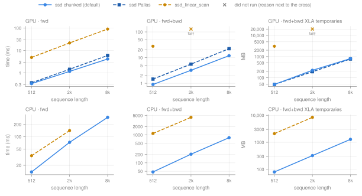
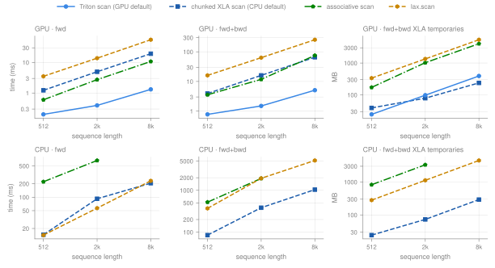
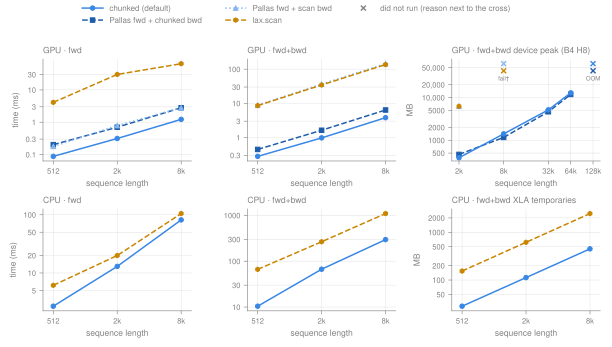
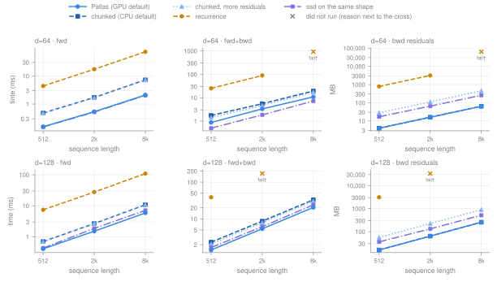
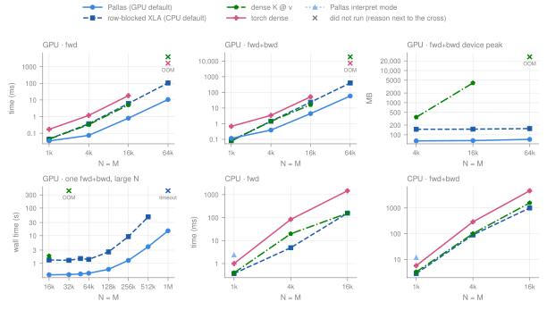
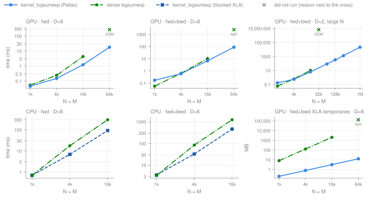
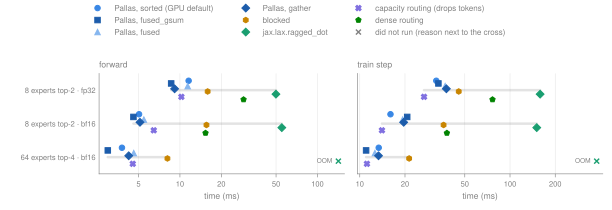
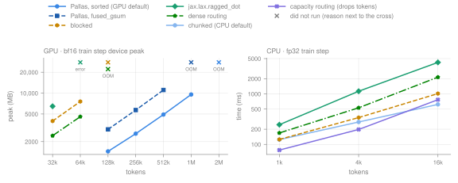

# Sequence-mixer, kernel-sum and MoE performance

probjax's non-softmax kernels against the alternatives in the library and outside it, on GPU and CPU: SSD, the Mamba selective scan, residual linear attention, Gated DeltaNet, kernel matrix-vector products and KDE, log-domain kernel reductions (Sinkhorn, OT), and the MoE grouped matmul. GPU: RTX 3090; CPU: shared 24-thread host, whose timings carry 10–30% run-to-run noise. Attention is on its [own page](gpu_attention.md), setup and methodology on the [overview](gpu_overview.md). fwd+bwd is the forward plus the gradient with respect to all array inputs. Times are medians in milliseconds. OOM: out of device memory. fail†: XLA found no kernel configuration that fits during autotuning (`NOT_FOUND`), so the case did not run. unsup.: the implementation rejects the shape or backend. error: another failure (the JSON row has the message). —: not measured.

## SSD (Mamba-2 state-space duality)

`ssd(q, k, v, log_alpha)` computes the Mamba-2 / SSD recurrence. `implementation=None` runs a chunked pure-JAX form (the Mamba-2 chunked algorithm with `remat='full'`) on CPU and GPU; `implementation='pallas'` selects the Triton kernel, and `ssd_linear_scan` is the per-step reference. `SSDCell` and `Mamba2Cell` are built on `ssd` ([models page](gpu_nn.md#ssmmodel-cells)).



*Batch 4, 2 groups, 8 heads, d_k = d_v = 128, fp32 ([`kernel_ssd_gpu.json`](kernel_ssd_gpu.json), [`kernel_ssd_cpu.json`](kernel_ssd_cpu.json)).*

Device peak at sequence length 8192 (fresh process, MB):

| config | implementation | fwd | fwd+bwd |
| --- | --- | ---: | ---: |
| g2h8_d128 | `ssd` chunked (default) | 1,128 | 1,323 |
| g2h8_d128 | `ssd` Pallas (`implementation='pallas'`) | 964 | 1,287 |
| g2h8_d128 | `ssd_linear_scan` | 964 | OOM |
| g1h1_d128 | `ssd` chunked (default) | 320 | 369 |
| g1h1_d128 | `ssd` Pallas (`implementation='pallas'`) | 176 | 241 |
| g1h1_d128 | `ssd_linear_scan` | 144 | 6,257 |

Longest power-of-two sequence whose fwd+bwd ran on the 24 GB card (g2h8_d128):

| implementation | longest sequence | peak there (MB) |
| --- | ---: | ---: |
| `ssd` chunked (default) | 65,536 | 12,076 |
| `ssd_linear_scan` | 1,024 | 6,228 |
| `ssd` Pallas (`implementation='pallas'`) | 65,536 | 10,260 |

??? note "Other head configurations (24 heads with d_v 64, one head, d_k 48 / d_v 40)"

    **GPU** ([`kernel_ssd_gpu.json`](kernel_ssd_gpu.json))

    | config | seq | mode | `ssd` chunked (default) | `ssd` Pallas (`implementation='pallas'`) | `ssd_linear_scan` |
    | --- | ---: | --- | ---: | ---: | ---: |
    | g1h24_dk128_dv64 | 512 | fwd | 0.258 | 0.321 | 4.71 |
    | g1h24_dk128_dv64 | 512 | fwd+bwd | 0.725 | 1.20 | 22.2 |
    | g1h24_dk128_dv64 | 2048 | fwd | 0.943 | 1.22 | 18.8 |
    | g1h24_dk128_dv64 | 2048 | fwd+bwd | 2.63 | 4.48 | OOM |
    | g1h24_dk128_dv64 | 8192 | fwd | 3.46 | 4.83 | 82.8 |
    | g1h24_dk128_dv64 | 8192 | fwd+bwd | 10.7 | 18.4 | OOM |
    | g1h1_d128 | 512 | fwd | 0.089 | 0.103 | 4.34 |
    | g1h1_d128 | 512 | fwd+bwd | 0.252 | 0.371 | 12.5 |
    | g1h1_d128 | 2048 | fwd | 0.284 | 0.389 | 17.5 |
    | g1h1_d128 | 2048 | fwd+bwd | 0.656 | 1.38 | 49.6 |
    | g1h1_d128 | 8192 | fwd | 0.909 | 1.53 | 67.9 |
    | g1h1_d128 | 8192 | fwd+bwd | 2.44 | 5.37 | 197 |
    | g2h4_dk48_dv40 | 512 | fwd | 0.112 | unsup. | unsup. |
    | g2h4_dk48_dv40 | 512 | fwd+bwd | 0.296 | unsup. | unsup. |
    | g2h4_dk48_dv40 | 2048 | fwd | 0.371 | unsup. | unsup. |
    | g2h4_dk48_dv40 | 2048 | fwd+bwd | 0.968 | unsup. | unsup. |
    | g2h4_dk48_dv40 | 8192 | fwd | 1.45 | unsup. | unsup. |
    | g2h4_dk48_dv40 | 8192 | fwd+bwd | 3.74 | unsup. | unsup. |

    **CPU** ([`kernel_ssd_cpu.json`](kernel_ssd_cpu.json))

    | config | seq | mode | `ssd` chunked (default) | `ssd` Pallas (`implementation='pallas'`) | `ssd_linear_scan` |
    | --- | ---: | --- | ---: | ---: | ---: |
    | g1h24_dk128_dv64 | 512 | fwd | 9.81 | — | 25.0 |
    | g1h24_dk128_dv64 | 512 | fwd+bwd | 41.1 | — | 814 |
    | g1h24_dk128_dv64 | 2048 | fwd | 62.0 | — | 133 |
    | g1h24_dk128_dv64 | 2048 | fwd+bwd | 175 | — | 3,047 |
    | g1h24_dk128_dv64 | 8192 | fwd | 242 | — | — |
    | g1h24_dk128_dv64 | 8192 | fwd+bwd | 706 | — | — |
    | g1h1_d128 | 512 | fwd | 1.71 | — | 3.82 |
    | g1h1_d128 | 512 | fwd+bwd | 5.01 | — | 119 |
    | g1h1_d128 | 2048 | fwd | 6.00 | — | 15.2 |
    | g1h1_d128 | 2048 | fwd+bwd | 28.5 | — | 496 |
    | g1h1_d128 | 8192 | fwd | 40.9 | — | — |
    | g1h1_d128 | 8192 | fwd+bwd | 119 | — | — |
    | g2h4_dk48_dv40 | 512 | fwd | 2.18 | — | unsup. |
    | g2h4_dk48_dv40 | 512 | fwd+bwd | 6.71 | — | unsup. |
    | g2h4_dk48_dv40 | 2048 | fwd | 8.47 | — | unsup. |
    | g2h4_dk48_dv40 | 2048 | fwd+bwd | 44.2 | — | unsup. |
    | g2h4_dk48_dv40 | 8192 | fwd | 59.2 | — | — |
    | g2h4_dk48_dv40 | 8192 | fwd+bwd | 176 | — | — |

**Accuracy**, relative (`max|a − b| / max|b|`) against an fp32 `HIGHEST`-precision run of the chunked algorithm: the chunked default's gradients differ by at most 1.3e-07 at sequence length 8192; the Pallas kernel runs its matmuls in TF32, with output error 5.2e-04 and gradient error up to 1.1e-02.

**When to use which.** Keep the default. On GPU the chunked form is at least as fast as the Triton kernel at the shapes above, keeps no residuals and runs any shape; it is the only fast path on CPU. `ssd_linear_scan` is a reference: its backward stores every state and runs out of memory at long sequences. `ssd()` forwards `chunk_size`, `remat`, `precision` and `return_final_state` to the chunked path.

## Mamba selective scan

`compute_mamba_scan` is the selective scan of `MambaCell`. On GPU it runs Triton sequence-loop kernels that keep the state in registers and recompute instead of storing states in the backward pass; on CPU, and on GPU for unsupported shapes, a chunked XLA scan with a custom VJP. The associative scan and `lax.scan` are the generic JAX alternatives.



*Batch 4, D 512, state 16, fp32; on CPU the associative scan was not run at 8192 ([`kernel_mamba_gpu.json`](kernel_mamba_gpu.json), [`kernel_mamba_cpu.json`](kernel_mamba_cpu.json)).*

Longest power-of-two sequence whose fwd+bwd ran on GPU (batch 4, D 1024, state 16; search limit 262,144):

| implementation | longest sequence | peak there (MB) |
| --- | ---: | ---: |
| Triton scan (GPU default) | 65,536 | 10,432 |
| chunked XLA scan (CPU default) | 65,536 | 7,570 |
| associative scan | 8,192 | 8,584 |
| `lax.scan` | 4,096 | 5,638 |

GPU device peak, batch 4, D 512 (fresh process, MB):

| seq | mode | Triton scan (GPU default) | chunked XLA scan (CPU default) | associative scan | `lax.scan` |
| --- | ---: | ---: | ---: | ---: | ---: |
| 2048 | fwd | 97.1 | 113 | 321 | 113 |
| 2048 | fwd+bwd | 195 | 195 | 1,091 | 1,411 |
| 8192 | fwd | 229 | 452 | 1,284 | 452 |
| 8192 | fwd+bwd | 776 | 502 | 4,360 | 5,642 |

The figure uses state 16; `MambaCell` defaults to `state_dim = model_dim`. GPU time of the Triton scan at larger states, median of three rounds ([`kernel_mamba_gpu_state.json`](kernel_mamba_gpu_state.json)), ms:

| B | L | D | state | fwd | bwd |
| --- | ---: | ---: | ---: | ---: | ---: |
| 2 | 4096 | 256 | 32 | 0.460 | 1.54 |
| 4 | 2048 | 512 | 64 | 0.980 | 3.96 |
| 4 | 2048 | 512 | 128 | 3.22 | 26.6 |
| 8 | 1024 | 128 | 16 | 0.210 | 0.570 |
| 8 | 1024 | 128 | 64 | 0.440 | 1.27 |
| 8 | 1024 | 128 | 128 | 0.920 | 6.52 |

??? note "D 256 and D 1024"

    **GPU**

    | D | seq | mode | Triton scan (GPU default) | chunked XLA scan (CPU default) | associative scan | `lax.scan` |
    | --- | ---: | ---: | ---: | ---: | ---: | ---: |
    | 256 | 512 | fwd | 0.171 | 0.537 | 0.245 | 3.52 |
    | 256 | 512 | fwd+bwd | 0.675 | 2.07 | 1.29 | 13.9 |
    | 256 | 2048 | fwd | 0.261 | 2.15 | 1.30 | 13.6 |
    | 256 | 2048 | fwd+bwd | 0.996 | 8.28 | 5.63 | 55.3 |
    | 256 | 8192 | fwd | 0.730 | 8.60 | 5.40 | 55.6 |
    | 256 | 8192 | fwd+bwd | 2.99 | 33.0 | 39.7 | 222 |
    | 1024 | 512 | fwd | 0.233 | 2.54 | 1.46 | 3.51 |
    | 1024 | 512 | fwd+bwd | 0.878 | 7.75 | 7.15 | 16.9 |
    | 1024 | 2048 | fwd | 0.639 | 9.75 | 5.62 | 14.0 |
    | 1024 | 2048 | fwd+bwd | 2.53 | 31.0 | 23.7 | 68.0 |
    | 1024 | 8192 | fwd | 2.21 | 41.2 | 23.0 | 55.6 |
    | 1024 | 8192 | fwd+bwd | 9.16 | 125 | 148 | OOM |

    **CPU**

    | D | seq | mode | chunked XLA scan (CPU default) | associative scan | `lax.scan` |
    | --- | ---: | ---: | ---: | ---: | ---: |
    | 256 | 512 | fwd | 6.40 | 91.1 | 17.2 |
    | 256 | 512 | fwd+bwd | 41.1 | 231 | 174 |
    | 256 | 2048 | fwd | 21.8 | 321 | 28.6 |
    | 256 | 2048 | fwd+bwd | 236 | 1,106 | 701 |
    | 256 | 8192 | fwd | 107 | — | 120 |
    | 256 | 8192 | fwd+bwd | 645 | — | 2,619 |
    | 1024 | 512 | fwd | 16.6 | 295 | 20.8 |
    | 1024 | 512 | fwd+bwd | 216 | 894 | 587 |
    | 1024 | 2048 | fwd | 95.4 | 1,275 | 176 |
    | 1024 | 2048 | fwd+bwd | 568 | 3,648 | 2,677 |
    | 1024 | 8192 | fwd | 299 | — | 319 |
    | 1024 | 8192 | fwd+bwd | 1,868 | — | 7,782 |

**Accuracy.** The fp32 implementations agree with `lax.scan` to 7.8e-05 relative error at sequence length 8192 (fwd+bwd, D 512).

**When to use which.** Keep the default dispatch. On GPU the Triton scan is the fastest measured implementation at every shape. On CPU the chunked scan is the fastest for fwd+bwd; for a forward-only pass `lax.scan` is within host noise of it and sometimes faster at D 512. The associative scan materializes `[B, L, D, S]` and `lax.scan` stores every state for the backward pass; both run out of memory well before the defaults.

## Residual linear attention (RAttention)

`residual_linear_attention`, the linear-attention branch of `RAttention`, defaults to a chunk-parallel pure-JAX form (`implementation='auto'`) on every backend. `implementation='pallas'` runs a Pallas forward with the chunked backward, `implementation='scan'` the token-by-token recurrence.



*Batch 2, 4 heads, D 64, chunk 128, fp32; device peak at batch 4, 8 heads ([`kernel_rla_gpu.json`](kernel_rla_gpu.json), [`kernel_rla_cpu.json`](kernel_rla_cpu.json)).*

**`RAttention` layer** end to end (forward, and gradient of a scalar loss), batch 2, 8 heads, head_dim 64, window 128. The layer runs out of memory at 8192 tokens on the 24 GB GPU because its sliding-window branch is dense:

| seq | mode | GPU chunked | GPU Pallas | GPU scan | CPU chunked | CPU scan |
| --- | ---: | ---: | ---: | ---: | ---: | ---: |
| 512 | fwd | 0.372 | 0.437 | 4.16 | 20.3 | 40.0 |
| 512 | fwd+bwd | 1.21 | 1.33 | 12.2 | 81.1 | 195 |
| 2048 | fwd | 2.45 | 2.57 | 17.9 | 295 | 333 |
| 2048 | fwd+bwd | 7.60 | 8.02 | 46.4 | 865 | 1,286 |
| 8192 | fwd | OOM | OOM | OOM | — | — |
| 8192 | fwd+bwd | OOM | OOM | fail† | — | — |

??? note "GPU bf16 kernel timings"

    | D | seq | mode | chunked (default) | Pallas fwd + chunked bwd | Pallas fwd + scan bwd | `lax.scan` |
    | --- | ---: | ---: | ---: | ---: | ---: | ---: |
    | 32 | 512 | fwd | 0.049 | 0.063 | — | 4.20 |
    | 32 | 512 | fwd+bwd | 0.111 | 0.132 | — | 7.97 |
    | 32 | 2048 | fwd | 0.088 | 0.215 | — | 16.3 |
    | 32 | 2048 | fwd+bwd | 0.288 | 0.416 | — | 28.2 |
    | 32 | 8192 | fwd | 0.386 | 0.763 | — | 64.9 |
    | 32 | 8192 | fwd+bwd | 1.14 | 1.68 | — | 113 |
    | 64 | 512 | fwd | 0.053 | 0.174 | — | 4.12 |
    | 64 | 512 | fwd+bwd | 0.193 | 0.308 | — | 8.57 |
    | 64 | 2048 | fwd | 0.190 | 0.594 | — | 16.3 |
    | 64 | 2048 | fwd+bwd | 0.689 | 1.15 | — | 34.2 |
    | 64 | 8192 | fwd | 0.765 | 2.37 | — | 66.5 |
    | 64 | 8192 | fwd+bwd | 2.76 | 4.74 | — | 136 |
    | 128 | 512 | fwd | 0.108 | — | — | 4.38 |
    | 128 | 512 | fwd+bwd | 0.397 | — | — | 13.8 |
    | 128 | 2048 | fwd | 0.421 | — | — | 17.8 |
    | 128 | 2048 | fwd+bwd | 1.48 | — | — | 55.4 |
    | 128 | 8192 | fwd | 1.73 | — | — | 71.0 |
    | 128 | 8192 | fwd+bwd | 5.90 | — | — | OOM |

**Accuracy**, relative to the fp32 `lax.scan`: chunked 1.6e-06 (forward) and 4.9e-04 (fwd+bwd, max over outputs and gradients) at sequence length 8192, D 64; the Pallas forward 3.1e-04 (TF32).

**When to use which.** Keep `implementation='auto'`: the chunked form is the fastest measured option on both backends and its backward does not store per-token state the way the scan backward does.

## Gated DeltaNet

`gated_delta_rule(implementation='auto')` runs `gated_delta_rule_pallas` on GPU for supported chunk and head sizes, and the chunked pure-JAX form (`gated_delta_rule_chunked`, WY/UT representation with a hand-written VJP that keeps only chunk-boundary states) otherwise and on CPU. `gated_delta_rule_recurrent` is the token-by-token reference. `ssd` on the same shape is plotted as a cost reference; it has no delta-rule correction term. `GatedDeltaNetCell` is built on it.



*bf16, batch 4, 8 heads, chunk 64, d_k = d_v = d, RTX 3090 ([`kernel_delta_gpu.json`](kernel_delta_gpu.json)).*

??? note "GPU fp32 timings"

    | d | seq | mode | Pallas (GPU default) | Pallas, unfused | chunked (CPU default) | chunked, more residuals | recurrence | `ssd` on the same shape |
    | --- | ---: | ---: | ---: | ---: | ---: | ---: | ---: | ---: |
    | 64 | 512 | fwd | — | — | — | — | — | — |
    | 64 | 512 | fwd+bwd | — | — | — | — | — | — |
    | 64 | 2048 | fwd | 0.771 | 0.788 | 1.73 | 1.73 | 17.0 | 0.386 |
    | 64 | 2048 | fwd+bwd | 3.33 | 3.43 | 5.58 | 4.69 | 94.2 | 1.63 |
    | 64 | 8192 | fwd | 2.77 | 2.76 | 7.00 | 7.22 | 73.8 | 1.55 |
    | 64 | 8192 | fwd+bwd | 11.6 | 11.7 | 25.9 | 18.0 | fail† | 5.85 |
    | 128 | 512 | fwd | — | — | — | — | — | — |
    | 128 | 512 | fwd+bwd | — | — | — | — | — | — |
    | 128 | 2048 | fwd | 1.61 | 1.61 | 2.79 | 2.79 | 31.0 | 1.58 |
    | 128 | 2048 | fwd+bwd | 5.80 | 5.81 | 8.87 | 7.99 | fail† | 6.11 |
    | 128 | 8192 | fwd | 6.10 | 6.11 | 11.3 | 11.3 | 109 | 6.30 |
    | 128 | 8192 | fwd+bwd | 22.1 | 22.1 | 34.3 | 31.1 | OOM | 24.1 |

**CPU**, fp32, batch 2, 8 heads ([`kernel_delta_cpu.json`](kernel_delta_cpu.json); the recurrence was not run at 8192), ms:

| d | seq | mode | chunked (CPU default) | chunked, more residuals | recurrence | `ssd` on the same shape |
| --- | ---: | ---: | ---: | ---: | ---: | ---: |
| 64 | 512 | fwd | 7.65 | 7.55 | 8.85 | unsup. |
| 64 | 512 | fwd+bwd | 22.9 | 21.3 | 175 | unsup. |
| 64 | 2048 | fwd | 40.7 | 42.3 | 39.8 | unsup. |
| 64 | 2048 | fwd+bwd | 125 | 112 | 756 | unsup. |
| 64 | 8192 | fwd | 179 | 179 | — | unsup. |
| 64 | 8192 | fwd+bwd | 535 | 483 | — | unsup. |
| 128 | 512 | fwd | 15.8 | 17.4 | 48.2 | unsup. |
| 128 | 512 | fwd+bwd | 59.3 | 56.4 | 801 | unsup. |
| 128 | 2048 | fwd | 86.2 | 84.4 | 163 | unsup. |
| 128 | 2048 | fwd+bwd | 259 | 248 | 3,274 | unsup. |

**Accuracy**, relative to an fp32 `HIGHEST`-precision chunked reference: bf16 Pallas 4.5e-03 (fwd+bwd, d 128, sequence length 8192), fp32 Pallas 5.4e-04.

**When to use which.** Use the default. The recurrence stores every state in its backward pass and fails at long sequences. Compared with `ssd` on the same shape, Gated DeltaNet is cheaper at d 128 and more expensive at d 64 on this GPU; choose between them for the model, not the kernel.

## RBF kernel matrix-vector products and KDE

`rbf_kernel_mv` computes `K(q, k) @ v` without materializing K; `kde_density` and `rbf_kde_density` build on it. The default is the Pallas kernel on GPU and a row-blocked XLA implementation on CPU (`implementation='xla'` on either).



*fp32, D 8, 16 output columns, batch 1; GPU device peak in a fresh process ([`kernel_kmv_gpu.json`](kernel_kmv_gpu.json), [`kernel_kmv_cpu.json`](kernel_kmv_cpu.json)).*

GPU `kde_density`, ms:

| D | N = M | mode | Pallas (GPU default) | row-blocked XLA (CPU default) | dense K @ v |
| --- | ---: | ---: | ---: | ---: | ---: |
| 2 | 1,024 | fwd | 0.038 | 0.042 | 0.044 |
| 2 | 1,024 | fwd+bwd | 0.059 | 0.051 | 0.061 |
| 2 | 4,096 | fwd | 0.080 | 0.212 | 0.327 |
| 2 | 4,096 | fwd+bwd | 0.172 | 0.686 | 0.574 |
| 2 | 16,384 | fwd | 0.679 | 3.35 | 4.99 |
| 2 | 16,384 | fwd+bwd | 1.55 | 11.1 | 8.75 |
| 2 | 65,536 | fwd | 8.55 | 52.7 | fail† |
| 2 | 65,536 | fwd+bwd | 20.1 | 177 | fail† |
| 8 | 1,024 | fwd | 0.044 | 0.043 | 0.043 |
| 8 | 1,024 | fwd+bwd | 0.057 | 0.047 | 0.050 |
| 8 | 4,096 | fwd | 0.079 | 0.210 | 0.326 |
| 8 | 4,096 | fwd+bwd | 0.168 | 0.681 | 0.576 |
| 8 | 16,384 | fwd | 0.692 | 3.37 | 4.98 |
| 8 | 16,384 | fwd+bwd | 1.58 | 11.1 | 8.78 |
| 8 | 65,536 | fwd | 8.71 | 55.2 | fail† |
| 8 | 65,536 | fwd+bwd | 20.5 | 184 | OOM |

??? note "`rbf_kernel_mv` at every measured shape"

    **GPU**

    | D | outputs | N = M | mode | Pallas (GPU default) | row-blocked XLA (CPU default) | dense K @ v | torch dense |
    | --- | ---: | ---: | ---: | ---: | ---: | ---: | ---: |
    | 2 | 1 | 1,024 | fwd | 0.053 | 0.050 | 0.050 | 0.168 |
    | 2 | 1 | 1,024 | fwd+bwd | 0.114 | 0.066 | 0.065 | 0.738 |
    | 2 | 1 | 4,096 | fwd | 0.081 | 0.210 | 0.329 | 1.15 |
    | 2 | 1 | 4,096 | fwd+bwd | 0.356 | 1.02 | 0.809 | 3.36 |
    | 2 | 1 | 16,384 | fwd | 0.685 | 3.60 | 5.00 | 17.7 |
    | 2 | 1 | 16,384 | fwd+bwd | 3.66 | 16.7 | 13.7 | 51.4 |
    | 2 | 1 | 65,536 | fwd | 8.56 | 53.0 | OOM | OOM |
    | 2 | 1 | 65,536 | fwd+bwd | 49.1 | 244 | OOM | OOM |
    | 8 | 1 | 1,024 | fwd | 0.058 | 0.045 | 0.046 | 0.178 |
    | 8 | 1 | 1,024 | fwd+bwd | 0.110 | 0.062 | 0.062 | 0.767 |
    | 8 | 1 | 4,096 | fwd | 0.080 | 0.210 | 0.329 | 1.15 |
    | 8 | 1 | 4,096 | fwd+bwd | 0.352 | 1.02 | 0.809 | 3.35 |
    | 8 | 1 | 16,384 | fwd | 0.690 | 3.64 | 5.00 | 17.8 |
    | 8 | 1 | 16,384 | fwd+bwd | 3.72 | 16.9 | 13.7 | 51.6 |
    | 8 | 1 | 65,536 | fwd | 9.89 | 58.2 | OOM | OOM |
    | 8 | 1 | 65,536 | fwd+bwd | 49.9 | 259 | OOM | OOM |
    | 8 | 16 | 1,024 | fwd | 0.035 | 0.045 | 0.045 | 0.171 |
    | 8 | 16 | 1,024 | fwd+bwd | 0.115 | 0.082 | 0.079 | 0.678 |
    | 8 | 16 | 4,096 | fwd | 0.075 | 0.370 | 0.330 | 1.18 |
    | 8 | 16 | 4,096 | fwd+bwd | 0.390 | 1.44 | 1.42 | 3.41 |
    | 8 | 16 | 16,384 | fwd | 0.805 | 6.14 | 5.02 | 18.1 |
    | 8 | 16 | 16,384 | fwd+bwd | 4.40 | 23.6 | 16.1 | 51.9 |
    | 8 | 16 | 65,536 | fwd | 10.6 | 105 | OOM | OOM |
    | 8 | 16 | 65,536 | fwd+bwd | 58.7 | 399 | OOM | OOM |
    | 32 | 1 | 1,024 | fwd | 0.054 | 0.052 | 0.049 | 0.169 |
    | 32 | 1 | 1,024 | fwd+bwd | 0.201 | 0.066 | 0.068 | 0.754 |
    | 32 | 1 | 4,096 | fwd | 0.167 | 0.219 | 0.334 | 1.19 |
    | 32 | 1 | 4,096 | fwd+bwd | 0.673 | 1.06 | 0.827 | 3.41 |
    | 32 | 1 | 16,384 | fwd | 1.86 | 4.13 | 5.15 | 18.5 |
    | 32 | 1 | 16,384 | fwd+bwd | 7.71 | 18.6 | 14.0 | 52.3 |
    | 32 | 1 | 65,536 | fwd | 23.7 | 72.6 | OOM | OOM |
    | 32 | 1 | 65,536 | fwd+bwd | 106 | 354 | OOM | OOM |
    | 32 | 16 | 1,024 | fwd | 0.053 | 0.049 | 0.048 | 0.172 |
    | 32 | 16 | 1,024 | fwd+bwd | 0.216 | 0.079 | 0.078 | 0.677 |
    | 32 | 16 | 4,096 | fwd | 0.176 | 0.381 | 0.336 | 1.22 |
    | 32 | 16 | 4,096 | fwd+bwd | 0.734 | 1.48 | 1.43 | 3.47 |
    | 32 | 16 | 16,384 | fwd | 2.00 | 6.58 | 5.17 | 18.8 |
    | 32 | 16 | 16,384 | fwd+bwd | 8.34 | 25.3 | 16.5 | 52.7 |
    | 32 | 16 | 65,536 | fwd | 25.1 | 122 | OOM | OOM |
    | 32 | 16 | 65,536 | fwd+bwd | 112 | 483 | OOM | OOM |

    **CPU**

    | D | outputs | N = M | mode | row-blocked XLA (CPU default) | Pallas interpret mode | dense K @ v | torch dense |
    | --- | ---: | ---: | ---: | ---: | ---: | ---: | ---: |
    | 2 | 1 | 1,024 | fwd | 0.317 | 2.29 | 0.720 | 4.20 |
    | 2 | 1 | 1,024 | fwd+bwd | 1.95 | 11.4 | 2.83 | 4.01 |
    | 2 | 1 | 4,096 | fwd | 13.7 | — | 15.5 | 81.2 |
    | 2 | 1 | 4,096 | fwd+bwd | 60.9 | — | 98.0 | 253 |
    | 8 | 1 | 1,024 | fwd | 0.435 | 2.37 | 0.409 | 0.818 |
    | 8 | 1 | 1,024 | fwd+bwd | 1.96 | 12.0 | 2.97 | 4.01 |
    | 8 | 1 | 4,096 | fwd | 4.96 | — | 20.1 | 82.4 |
    | 8 | 1 | 4,096 | fwd+bwd | 83.5 | — | 97.1 | 253 |
    | 8 | 16 | 1,024 | fwd | 0.369 | 2.38 | 0.395 | 1.00 |
    | 8 | 16 | 1,024 | fwd+bwd | 2.83 | 11.9 | 3.27 | 5.72 |
    | 8 | 16 | 4,096 | fwd | 4.89 | — | 19.7 | 83.5 |
    | 8 | 16 | 4,096 | fwd+bwd | 89.5 | — | 101 | 289 |
    | 8 | 16 | 16,384 | fwd | 156 | — | 155 | 1,464 |
    | 8 | 16 | 16,384 | fwd+bwd | 996 | — | 1,570 | 4,630 |
    | 32 | 1 | 1,024 | fwd | 0.468 | 2.96 | 0.481 | 1.02 |
    | 32 | 1 | 1,024 | fwd+bwd | 2.06 | 15.3 | 3.13 | 4.14 |
    | 32 | 1 | 4,096 | fwd | 6.08 | — | 20.3 | 79.7 |
    | 32 | 1 | 4,096 | fwd+bwd | 82.8 | — | 99.0 | 256 |
    | 32 | 16 | 1,024 | fwd | 0.439 | 2.97 | 0.457 | 1.00 |
    | 32 | 16 | 1,024 | fwd+bwd | 3.04 | 15.6 | 3.48 | 5.16 |
    | 32 | 16 | 4,096 | fwd | 9.67 | — | 20.4 | 89.3 |
    | 32 | 16 | 4,096 | fwd+bwd | 95.3 | — | 102 | 279 |

**Accuracy.** Each JSON row carries `rel_err`, the norm-relative error against the row-blocked XLA implementation at `HIGHEST` matmul precision; the Pallas kernel is within 3.6e-04 (fwd+bwd, D 8, N = 16384, largest gradient error).

**When to use which.** Keep the defaults. At N = 1024 the dense product and the XLA path are faster than the Pallas kernel in fwd+bwd; from a few thousand points on the kernel is the fastest, and the dense product runs out of memory around N = 32k on the 24 GB GPU. The Pallas kernel ran fwd+bwd at N = 1,048,576 with a 320 MB device peak.

## Log-domain kernel reductions, Sinkhorn and OT

`kernel_logsumexp` computes `logsumexp_j(-c(x_i, y_j) / ε + g_j)` without materializing the N × M cost: a Pallas kernel on GPU (cross term in 3×TF32), blocked XLA on CPU, dense for small problems. `probjax.nn.ot` builds on it (Sinkhorn with implicit or unrolled gradients, Sinkhorn divergence, entropic map, plan sampler, MMD, KDE log-density, `ot_pairing`); `FlowMatcher` / `LinearFlow` accept `ot_coupling=None | 'exact' | 'sinkhorn'`. The comparison is a dense `jax.nn.logsumexp` on the materialized cost (ott-jax is not installed).



*fp32, N = M ([`kernel_ot_gpu.json`](kernel_ot_gpu.json), [`kernel_ot_cpu.json`](kernel_ot_cpu.json)).*

??? note "D 2 and D 32"

    | device | D | N = M | fwd kernel | fwd dense | fwd+bwd kernel | fwd+bwd dense |
    | --- | ---: | ---: | ---: | ---: | ---: | ---: |
    | GPU | 2 | 1,024 | 0.045 | 0.054 | 0.175 | 0.058 |
    | GPU | 2 | 4,096 | 0.152 | 0.243 | 0.570 | 0.647 |
    | GPU | 2 | 16,384 | 1.22 | 4.48 | 6.51 | 10.7 |
    | GPU | 2 | 65,536 | 15.9 | OOM | 87.2 | OOM |
    | GPU | 32 | 1,024 | 0.073 | 0.063 | 0.325 | 0.065 |
    | GPU | 32 | 4,096 | 0.273 | 0.276 | 1.12 | 0.698 |
    | GPU | 32 | 16,384 | 2.53 | 4.89 | 15.0 | 12.1 |
    | GPU | 32 | 65,536 | 35.9 | OOM | 239 | OOM |
    | CPU | 2 | 1,024 | 0.696 | 0.664 | 2.44 | 2.66 |
    | CPU | 2 | 4,096 | 6.89 | 23.7 | 29.9 | 94.8 |
    | CPU | 2 | 16,384 | 101 | 328 | 485 | 1,387 |
    | CPU | 32 | 1,024 | 0.685 | 0.644 | 2.78 | 3.07 |
    | CPU | 32 | 4,096 | 7.16 | 19.2 | 31.9 | 78.3 |
    | CPU | 32 | 16,384 | 105 | 303 | 483 | 1,200 |

GPU device peak (fresh process):

| implementation | N = M | D | mode | peak (MB) |
| --- | ---: | ---: | --- | ---: |
| `kernel_logsumexp` (Pallas) | 65,536 | 8 | fwd | 12.5 |
| `kernel_logsumexp` (Pallas) | 65,536 | 8 | fwd+bwd | 24.5 |
| dense logsumexp | 32,768 | 8 | fwd | 4,259 |
| dense logsumexp | 32,768 | 8 | fwd+bwd | OOM |
| `kernel_logsumexp` (Pallas) | 1,048,576 | 2 | fwd+bwd | 296 |

**Sinkhorn**, 50 log-domain iterations, D 8, against a dense log-domain solver on the materialized cost; the last column is the absolute difference of the two transport costs:

| device | N = M | kernel (ms) | dense (ms) | kernel + implicit grad (ms) | kernel temp (MB) | dense temp (MB) | cost difference |
| --- | ---: | ---: | ---: | ---: | ---: | ---: | ---: |
| GPU | 4,096 | 13.8 | 16.3 | 13.5 | 1.33 | 128 | 0 |
| GPU | 16,384 | 127 | 250 | 130 | 5.31 | 2,048 | 9.5e-07 |
| GPU | 65,536 | 1,656 | OOM | 1,688 | 21.3 | OOM | — |
| CPU | 4,096 | 536 | 1,110 | 538 | 17.0 | 129 | 0 |
| CPU | 16,384 | 8,475 | 19,861 | 8,719 | 19.5 | 2,051 | 9.5e-07 |

**Accuracy** against an fp64 reference, N = M = 2048. `dense_default_precision` is the dense fp32 computation at JAX's default (TF32) matmul precision, which is why the kernel computes the cross term in 3×TF32:

| device | implementation | D | ε | max abs err (logsumexp) | rel err (gradient) |
| --- | --- | ---: | ---: | ---: | ---: |
| GPU | dense | 8 | 0.5 | 8.9e-06 | 1.3e-06 |
| GPU | pallas | 8 | 0.5 | 1.3e-05 | 1.7e-06 |
| GPU | dense | 8 | 0.01 | 4.4e-04 | 3.9e-05 |
| GPU | pallas | 8 | 0.01 | 6.7e-04 | 5.1e-05 |
| GPU | dense | 32 | 0.05 | 3.3e-04 | 3.9e-05 |
| GPU | pallas | 32 | 0.05 | 4.4e-04 | 3.6e-05 |
| GPU | dense_default_precision | 8 | 0.01 | 1.2e+00 | — |
| CPU | dense | 8 | 0.5 | 7.0e-06 | 1.9e-06 |
| CPU | xla | 8 | 0.5 | 7.0e-06 | 1.8e-06 |
| CPU | dense | 8 | 0.01 | 4.8e-04 | 4.9e-05 |
| CPU | xla | 8 | 0.01 | 4.8e-04 | 6.0e-05 |
| CPU | dense | 32 | 0.05 | 3.4e-04 | 3.9e-05 |
| CPU | xla | 32 | 0.05 | 3.4e-04 | 3.8e-05 |

**OT-CFM** (`LinearFlow` from N(0, I) to 8 Gaussians, 3000 steps, batch 256, GPU). Straightness is lower for straighter paths; the Sinkhorn divergence to held-out target samples after 1, 2, 4 and 32 Euler steps measures sample quality (the floor is the divergence between two target samples):

| coupling | seed | ms / step | final loss | straightness | S-div 1 step | 2 steps | 4 steps | 32 steps | floor |
| --- | ---: | ---: | ---: | ---: | ---: | ---: | ---: | ---: | ---: |
| independent | 0 | 3.69 | 6.68 | 3.11 | 13.6 | 11.2 | 0.417 | 0.0532 | 0.0115 |
| exact | 0 | 12.1 | 0.203 | 0.108 | 0.322 | 2.45 | 0.278 | 0.0514 | 0.0115 |
| sinkhorn | 0 | 3.96 | 0.9 | 0.174 | 0.543 | 2.86 | 0.218 | 0.05 | 0.0115 |
| independent | 1 | 3.72 | 6.98 | 3.79 | 14.7 | 11.9 | 0.481 | 0.0592 | 0.0115 |
| exact | 1 | 12.2 | 0.144 | 0.1 | 0.302 | 2.26 | 0.341 | 0.0718 | 0.0115 |
| sinkhorn | 1 | 3.99 | 0.571 | 0.178 | 0.58 | 2.79 | 0.246 | 0.0439 | 0.0115 |

**When to use which.** On GPU the kernel matches or beats the dense forward from a few thousand points on and is the only option once the cost matrix no longer fits (dense fails from N = 32k–49k in the sweeps above). Its backward costs several times its forward, so for fwd+bwd at large D the dense form is faster while it fits (D 32, N = 16384: dense 12.1 ms vs kernel 15.0 ms, with 2,064 vs 0.188 MB of temporaries). For OT-CFM, Sinkhorn pairing costs little more per step than independent pairing and approaches the straightness of exact OT.

## MoE grouped matmul

`MoELayer(routing='dropless')` sorts token-expert assignments by expert and runs one grouped matmul. On GPU the default is the Pallas grouped GEMM (`dropless_impl='auto'`, `dropless_dispatch='sorted'`), which processes the grouped SwiGLU in row slabs so the train step holds no full-size intermediates; on CPU it is `dropless_impl='chunked'`, an XLA loop over expert-sorted row chunks. `routing='capacity'` drops tokens beyond the expert capacity and is not exact; `routing='dense'` runs every expert on every token.



*32768 tokens, d_model 512; 8 experts with d_hidden 1024, 64 experts with d_hidden 256; RTX 3090 ([`kernel_gmm_gpu.json`](kernel_gmm_gpu.json)).*



*Left: GPU device peak of the bf16 train step (8 experts top-2, fresh process). Right: CPU fp32 train step, 8 experts top-2 ([`kernel_gmm_cpu.json`](kernel_gmm_cpu.json)).*

Largest bf16 train step that ran on the 24 GB GPU:

| code path | max tokens |
| --- | ---: |
| Pallas, sorted (GPU default) | 1,048,576 |
| Pallas, fused_gsum | 524,288 |
| blocked | 65,536 |
| `jax.lax.ragged_dot` | 32,768 |
| dense routing | 65,536 |

**Accuracy**, relative output error against an fp32 dense-routing reference: 1.1e-02 for fp32 Pallas on GPU (TF32 matmuls), 3.2e-02 in bf16, 3.6e-08 for the CPU chunked path.

**When to use which.** Keep the defaults. On GPU with 8 experts the sorted Pallas dispatch has the fastest exact train step and fits the most tokens, `dropless_dispatch='fused_gsum'` the fastest forward; with many small experts (64, top-4) `fused_gsum` also wins the train step. `jax.lax.ragged_dot` is far slower on this GPU. On CPU `chunked` is the fastest exact path.

## How to reproduce

```bash
# Per-family runners (CUDA GPU); add JAX_PLATFORMS=cpu and --device cpu for the CPU files.
python -m docs.scripts.benchmark_kernel_ssd --device gpu --output docs/benchmarks/kernel_ssd_gpu.json
python -m docs.scripts.benchmark_kernel_mamba --device gpu --output docs/benchmarks/kernel_mamba_gpu.json
python -m docs.scripts.benchmark_kernel_rla --device gpu --suites kernel layer \
  --output docs/benchmarks/kernel_rla_gpu.json
python -m docs.scripts.benchmark_kernel_delta --device gpu --output docs/benchmarks/kernel_delta_gpu.json
python -m docs.scripts.benchmark_kernel_kmv --device gpu --output docs/benchmarks/kernel_kmv_gpu.json
python -m docs.scripts.benchmark_kernel_ot --device gpu --suite lse
python -m docs.scripts.benchmark_kernel_gmm --device gpu --output docs/benchmarks/kernel_gmm_gpu.json
JAX_PLATFORMS=cpu python -m docs.scripts.benchmark_kernel_ssd --device cpu \
  --output docs/benchmarks/kernel_ssd_cpu.json

# Rebuild the figures and this page from the JSON.
python -m docs.scripts.benchmark_figures
```

The Mamba runner's `--peak` and `--max-len` flags, and the `peak`, `scale` and `cfm` suites of the OT runner, produce the memory and largest-size rows.
