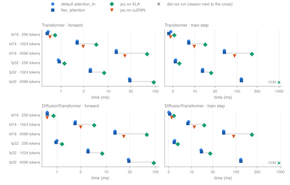
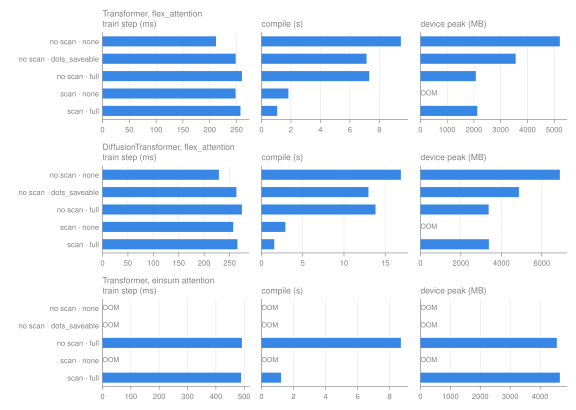
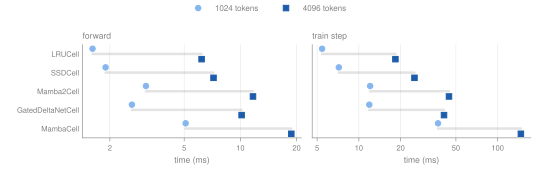

# Model performance (`probjax.nn`)

End-to-end forward and train-step cost of `probjax.nn` models and of the `scan_layers` / `remat_policy` options, measured on the RTX 3090 ([`gpu_nn.json`](gpu_nn.json), [`kernel_nn_gpu.json`](kernel_nn_gpu.json)) and on CPU ([`kernel_nn_cpu.json`](kernel_nn_cpu.json)). Kernel-level numbers are on the [attention](gpu_attention.md) and [kernel](gpu_kernels.md) pages, setup on the [overview](gpu_overview.md). A train step is `value_and_grad` of a scalar loss plus an optimizer update. Times are medians in milliseconds. OOM: out of device memory. fail†: XLA found no kernel configuration that fits during autotuning (`NOT_FOUND`), so the case did not run. unsup.: the implementation rejects the shape or backend. error: another failure (the JSON row has the message). —: not measured.

## Transformer and DiffusionTransformer

The standard profile (model width 256, 8 heads of 32, 4 layers), batch 8, with each `attention_fn`. The default `dot_product_attention` dispatches to `flex_attention` on NVIDIA GPUs ([rules](gpu_attention.md#short-sequences-and-the-default-dispatch)).



*Batch 8, width 256, 4 layers, RTX 3090. cuDNN has no fp32 path.*

At 4096 tokens in bf16 the default train step takes 59.8 ms against 87.4 ms with cuDNN attention; `jax.nn` XLA attention is OOM at that size. At this head size (32) the probjax kernel is faster than cuDNN in both the forward and the train step.

??? note "Table"

    | model | dtype | tokens | op | default `dot_product_attention` | `flex_attention` | `jax.nn` XLA | `jax.nn` cuDNN |
    | --- | ---: | ---: | ---: | ---: | ---: | ---: | ---: |
    | transformer | bf16 | 256 | forward | 0.525 | 0.531 | 0.739 | 0.581 |
    | transformer | bf16 | 256 | train step | 2.65 | 2.43 | 3.17 | 2.98 |
    | transformer | bf16 | 1024 | forward | 2.25 | 2.22 | 5.60 | 2.82 |
    | transformer | bf16 | 1024 | train step | 7.55 | 7.59 | 17.7 | 9.73 |
    | transformer | bf16 | 4096 | forward | 14.8 | 14.8 | 66.6 | 24.0 |
    | transformer | bf16 | 4096 | train step | 59.8 | 59.0 | OOM | 87.4 |
    | transformer | fp32 | 256 | forward | 0.908 | 0.908 | 1.18 | — |
    | transformer | fp32 | 256 | train step | 3.83 | 3.54 | 4.20 | — |
    | transformer | fp32 | 1024 | forward | 4.18 | 4.18 | 8.20 | — |
    | transformer | fp32 | 1024 | train step | 16.1 | 15.8 | 24.3 | — |
    | transformer | fp32 | 4096 | forward | 28.0 | 28.5 | OOM | — |
    | transformer | fp32 | 4096 | train step | 136 | 136 | OOM | — |
    | diffusion | bf16 | 256 | forward | 0.626 | 0.625 | 0.835 | 0.675 |
    | diffusion | bf16 | 256 | train step | 3.03 | 3.29 | 3.94 | 3.63 |
    | diffusion | bf16 | 1024 | forward | 2.35 | 2.36 | 5.68 | 3.05 |
    | diffusion | bf16 | 1024 | train step | 8.57 | 8.37 | 18.9 | 10.8 |
    | diffusion | bf16 | 4096 | forward | 15.0 | 15.0 | 66.9 | 22.7 |
    | diffusion | bf16 | 4096 | train step | 61.9 | 61.4 | OOM | 89.7 |
    | diffusion | fp32 | 256 | forward | 0.995 | 0.996 | 1.26 | — |
    | diffusion | fp32 | 256 | train step | 4.44 | 4.18 | 4.69 | — |
    | diffusion | fp32 | 1024 | forward | 4.24 | 4.25 | 8.27 | — |
    | diffusion | fp32 | 1024 | train step | 17.2 | 17.2 | 25.7 | — |
    | diffusion | fp32 | 4096 | forward | 28.5 | 28.2 | OOM | — |
    | diffusion | fp32 | 4096 | train step | 138 | 138 | OOM | — |

## Scan over layers and rematerialization

`Transformer` and `DiffusionTransformer` take `remat_policy=None | 'full' | 'nothing_saveable' | <jax.checkpoint_policies name> | callable` and `scan_layers=False`. `scan_layers=True` stacks the layer parameters and runs the blocks under `jax.lax.scan`; it changes the parameter tree, so checkpoints of an unscanned model do not load into a scanned one. Both are opt-in.



*24 layers, width 512, 4096 tokens, batch 2, bf16, RTX 3090; device peak in a fresh process. The last row uses einsum attention (`implementation='xla'`), which materializes the scores.*

`remat_policy='full'` cuts the device peak of the 24-layer bf16 model from 5,212 to 2,072 MB for 260 instead of 212 ms per step (the forward runs twice), and is what lets the einsum-attention model train at all at this length. `scan_layers=True` compiles in 1.07 s instead of 7.32 s, but without remat it keeps every layer's activations as scan residuals and runs out of memory. For deep stacks use `scan_layers=True, remat_policy='full'`; `dots_saveable` sits between the two.

??? note "Tables (GPU 24 and 12 layers; CPU)"

    **GPU, Transformer, 24 layers, `flex_attention`**

    | `scan_layers` | `remat_policy` | train step (ms) | compile (s) | XLA temp (MB) | device peak (MB) |
    | --- | --- | ---: | ---: | ---: | ---: |
    | no | none | 212 | 9.46 | 3,460 | 5,212 |
    | no | dots_saveable | 248 | 7.13 | 1,808 | 3,560 |
    | no | full | 260 | 7.32 | 320 | 2,072 |
    | yes | none | 248 | 1.83 | 7,373 | OOM |
    | yes | full | 257 | 1.07 | 235 | 2,126 |

    **GPU, DiffusionTransformer, 24 layers, `flex_attention`**

    | `scan_layers` | `remat_policy` | train step (ms) | compile (s) | XLA temp (MB) | device peak (MB) |
    | --- | --- | ---: | ---: | ---: | ---: |
    | no | none | 229 | 16.9 | 3,848 | 6,894 |
    | no | dots_saveable | 263 | 13.0 | 1,824 | 4,870 |
    | no | full | 274 | 13.8 | 328 | 3,374 |
    | yes | none | 257 | 2.90 | 8,081 | OOM |
    | yes | full | 265 | 1.55 | 204 | 3,385 |

    **GPU, Transformer, 24 layers, einsum attention**

    | `scan_layers` | `remat_policy` | train step (ms) | compile (s) | XLA temp (MB) | device peak (MB) |
    | --- | --- | ---: | ---: | ---: | ---: |
    | no | none | OOM | — | — | OOM |
    | no | dots_saveable | OOM | — | — | OOM |
    | no | full | 492 | 8.69 | 2,808 | 4,560 |
    | yes | none | OOM | — | — | OOM |
    | yes | full | 489 | 1.22 | 2,769 | 4,661 |

    **GPU, Transformer, 12 layers, einsum attention**

    | `scan_layers` | `remat_policy` | train step (ms) | compile (s) | XLA temp (MB) | device peak (MB) |
    | --- | --- | ---: | ---: | ---: | ---: |
    | no | none | OOM | — | — | OOM |
    | no | dots_saveable | OOM | — | — | OOM |
    | no | full | 245 | 4.10 | 2,712 | 3,599 |
    | yes | none | OOM | — | — | OOM |
    | yes | full | 245 | 1.22 | 2,673 | 3,619 |

    **CPU, width 512, 512 tokens, batch 2, fp32, 24 layers**

    | `scan_layers` | `remat_policy` | train step (ms) | compile (s) | XLA temp (MB) | device peak (MB) |
    | --- | --- | ---: | ---: | ---: | ---: |
    | no | none | 1,755 | 3.19 | 2,042 | — |
    | no | dots_saveable | 1,541 | 3.06 | 670 | — |
    | no | full | 1,505 | 3.07 | 124 | — |
    | yes | none | 2,110 | 0.52 | 2,130 | — |
    | yes | full | 1,611 | 0.45 | 26.0 | — |

    **CPU, 12 layers**

    | `scan_layers` | `remat_policy` | train step (ms) | compile (s) | XLA temp (MB) | device peak (MB) |
    | --- | --- | ---: | ---: | ---: | ---: |
    | no | none | 881 | 1.56 | 1,034 | — |
    | no | dots_saveable | 785 | 1.42 | 382 | — |
    | no | full | 761 | 1.40 | 124 | — |
    | yes | none | 1,035 | 0.49 | 1,101 | — |
    | yes | full | 811 | 0.44 | 40.0 | — |

On CPU (24 layers, 512 tokens), `remat_policy='full'` is also faster, not only smaller: 1,505 vs 1,755 ms per step, because the smaller working set stays in cache.

## SSMModel cells

`SSMModel(16, 128, 16, 4)` with each recurrent cell, batch 8, fp32. `Mamba2Cell` is the full Mamba-2 block on `ssd` (`expand=2`, short causal convolution, gated RMSNorm, `head_dim=64`, `state_dim=64`); `SSDCell` is a multi-head SSD layer with the Mamba-2 decay parameterization; `MambaCell` uses `state_dim = model_dim` by default; `GatedDeltaNetCell` and `LRUCell` use their defaults.



*`SSMModel(16, 128, 16, 4)`, batch 8, fp32, RTX 3090.*

| cell | parameters | tokens | forward (ms) | train step (ms) | train-step compile (s) |
| --- | ---: | ---: | ---: | ---: | ---: |
| `LRUCell` | 995,728 | 1024 | 1.61 | 5.43 | 5.07 |
| `LRUCell` | 995,728 | 4096 | 6.20 | 18.3 | 5.53 |
| `SSDCell` | 863,644 | 1024 | 1.90 | 7.17 | 10.4 |
| `SSDCell` | 863,644 | 4096 | 7.18 | 25.2 | 10.8 |
| `Mamba2Cell` | 1,136,064 | 1024 | 3.12 | 12.1 | 11.3 |
| `Mamba2Cell` | 1,136,064 | 4096 | 11.7 | 44.6 | 10.1 |
| `GatedDeltaNetCell` | 1,006,144 | 1024 | 2.62 | 11.9 | 8.33 |
| `GatedDeltaNetCell` | 1,006,144 | 4096 | 10.2 | 41.1 | 8.49 |
| `MambaCell` | 930,704 | 1024 | 5.09 | 37.2 | 6.38 |
| `MambaCell` | 930,704 | 4096 | 18.7 | 147 | 6.29 |

For the kernels underneath see [SSD](gpu_kernels.md#ssd-mamba-2-state-space-duality), [Mamba](gpu_kernels.md#mamba-selective-scan) and [Gated DeltaNet](gpu_kernels.md#gated-deltanet).

## UNet

`UNet(3, (64, 128, 256))`, batch 8, RTX 3090; device peak in a fresh process:

| dtype | resolution | op | time (ms) | XLA temp (MB) | device peak (MB) |
| --- | ---: | ---: | ---: | ---: | ---: |
| bf16 | 32 | forward | 1.15 | 11.8 | — |
| bf16 | 32 | train step | 3.97 | 72.7 | — |
| bf16 | 64 | forward | 2.91 | 44.8 | 254 |
| bf16 | 64 | train step | 10.1 | 225 | 398 |
| fp32 | 32 | forward | 1.64 | 23.5 | — |
| fp32 | 32 | train step | 5.41 | 114 | — |
| fp32 | 64 | forward | 4.70 | 83.0 | 261 |
| fp32 | 64 | train step | 15.3 | 436 | 12,662 |

bf16 train step at resolution 64 with remat or donated buffers. Remat costs time without reducing temporaries at this size:

| variant | time (ms) | compile (s) | XLA temp (MB) |
| --- | ---: | ---: | ---: |
| plain | 9.56 | 14.4 | 225 |
| remat | 13.3 | 2.53 | 231 |
| donate | 9.41 | 2.27 | 238 |

## MoE layer

Dropless `MoELayer`, 8 experts, top-2, d_model 512, d_hidden 1024, one column per `dropless_impl`. More code paths, memory and the largest token counts are on the [kernel page](gpu_kernels.md#moe-grouped-matmul):

| dtype | tokens | op | Pallas (default) | blocked | `ragged_dot` |
| --- | ---: | ---: | ---: | ---: | ---: |
| bf16 | 4,096 | forward | 0.857 | 2.35 | 6.69 |
| bf16 | 4,096 | train step | 2.73 | 5.69 | 19.2 |
| bf16 | 32,768 | forward | 5.06 | 15.6 | 48.8 |
| bf16 | 32,768 | train step | 15.9 | 36.4 | 144 |
| fp32 | 4,096 | forward | 1.29 | 2.37 | 6.66 |
| fp32 | 4,096 | train step | 4.64 | 5.80 | 19.4 |
| fp32 | 32,768 | forward | 9.29 | 15.6 | 48.9 |
| fp32 | 32,768 | train step | 31.9 | 36.4 | 146 |

## Training-loop overhead

Per-step time of an MLP trained with a bare jitted step and with `fit()` on an in-memory array and on a stream. `fit()` recompiles on every call: a second call with the same model and data costs nearly as much wall time as the first (last two columns).

| device | width | bare jit (ms/step) | `fit` array (ms/step) | `fit` stream (ms/step) | `fit` first call (s) | `fit` second call (s) |
| --- | ---: | ---: | ---: | ---: | ---: | ---: |
| GPU | 64 | 0.159 | 0.205 | 0.378 | 0.60 | 0.36 |
| GPU | 512 | 0.459 | 0.532 | 0.636 | 0.85 | 0.65 |
| CPU | 64 | 0.142 | 0.130 | 0.227 | 0.40 | 0.29 |
| CPU | 512 | 23.4 | 13.4 | 17.7 | 3.09 | 2.97 |

## How to reproduce

```bash
# Model grid (Transformer, DiffusionTransformer, SSM cells, UNet, MoE).
python -m docs.scripts.benchmark_gpu_nn --output docs/benchmarks/gpu_nn.json

# scan_layers / remat_policy, UNet variants, training loop; --peak adds device peaks.
python -m docs.scripts.benchmark_kernel_nn --device gpu --output docs/benchmarks/kernel_nn_gpu.json
JAX_PLATFORMS=cpu python -m docs.scripts.benchmark_kernel_nn --device cpu \
  --output docs/benchmarks/kernel_nn_cpu.json

# Rebuild the figures and this page from the JSON.
python -m docs.scripts.benchmark_figures
```
