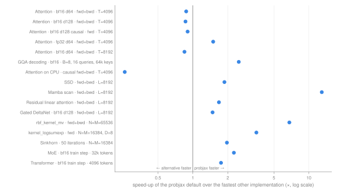

# GPU and CPU performance

How probjax's kernels and models compare with the alternatives in JAX and PyTorch, in time and memory, on a consumer NVIDIA GPU and on CPU:

- [Attention](gpu_attention.md): `dot_product_attention`, `flex_attention` and `mha` against `jax.nn` (XLA, cuDNN) and PyTorch SDPA; memory, short sequences, GQA and split-KV decoding, CPU.
- [Sequence mixers, kernel sums and MoE](gpu_kernels.md): SSD, Mamba scan, residual linear attention, Gated DeltaNet, `rbf_kernel_mv` / KDE, `kernel_logsumexp` / Sinkhorn / OT, MoE grouped matmul.
- [Models](gpu_nn.md): `Transformer` / `DiffusionTransformer` per `attention_fn`, `scan_layers` and `remat_policy`, `SSMModel` cells, `UNet`, `MoELayer`.

## At a glance



*Time of the fastest other implementation that ran (another probjax implementation or an external library) divided by the time of the probjax default, RTX 3090; the CPU row ran on the shared host. Right of the line: the default is faster.*

| workload | probjax default | ms | fastest other implementation | ms | speed-up |
| --- | --- | ---: | --- | ---: | ---: |
| Attention · bf16 d64 · fwd+bwd · T=4096 | probjax `dot_product_attention` (default) | 9.37 | torch SDPA flash | 7.78 | 0.83× |
| Attention · bf16 d128 · fwd+bwd · T=4096 | probjax `dot_product_attention` (default) | 20.2 | torch SDPA flash | 15.1 | 0.74× |
| Attention · bf16 d128 causal · fwd · T=4096 | probjax `dot_product_attention` (default) | 2.47 | torch SDPA flash | 2.23 | 0.90× |
| Attention · fp32 d64 · fwd+bwd · T=4096 | probjax `dot_product_attention` (default) | 23.6 | `jax.nn` XLA | 29.3 | 1.24× |
| Attention · bf16 d64 · fwd+bwd · T=8192 | probjax `dot_product_attention` (default) | 39.0 | torch SDPA flash | 28.8 | 0.74× |
| GQA decoding · bf16 · B=8, 16 queries, 64k keys | probjax split-KV (default) | 4.02 | `jax.nn` cuDNN | 9.99 | 2.49× |
| Attention on CPU · causal fwd+bwd · T=4096 | probjax `mha` (auto strategy) | 392 | torch SDPA | 101 | 0.26× |
| SSD · fwd+bwd · L=8192 | `ssd` chunked (default) | 11.9 | `ssd` Pallas (`implementation='pallas'`) | 22.2 | 1.87× |
| Mamba scan · fwd+bwd · L=8192 | Triton scan (GPU default) | 5.07 | chunked XLA scan (CPU default) | 65.6 | 13× |
| Residual linear attention · fwd+bwd · L=8192 | chunked (default) | 3.79 | Pallas fwd + chunked bwd | 6.36 | 1.68× |
| Gated DeltaNet · bf16 d128 · fwd+bwd · L=8192 | Pallas (GPU default) | 20.5 | chunked, more residuals | 30.4 | 1.48× |
| rbf_kernel_mv · fwd+bwd · N=M=65536 | Pallas (GPU default) | 58.7 | row-blocked XLA (CPU default) | 399 | 6.79× |
| kernel_logsumexp · fwd · N=M=16384, D=8 | `kernel_logsumexp` (Pallas) | 1.24 | dense logsumexp | 4.38 | 3.53× |
| Sinkhorn · 50 iterations · N=M=16384 | `kernel_logsumexp` (Pallas) | 127 | dense logsumexp | 250 | 1.96× |
| MoE · bf16 train step · 32k tokens | Pallas, sorted (GPU default) | 16.0 | blocked | 36.1 | 2.26× |
| Transformer · bf16 train step · 4096 tokens | default `dot_product_attention` | 59.8 | `jax.nn` cuDNN | 87.4 | 1.46× |

Exact shapes are on the linked pages; ratios at other shapes differ, sometimes a lot.

## Setup

|  |  |
| --- | --- |
| GPU | NVIDIA GeForce RTX 3090, 24 GB (sm_86, about 99 KB opt-in shared memory per block) |
| Driver | 615.78.08 |
| JAX | 0.11.2 (Pallas on Triton for GPU kernels) |
| PyTorch (comparisons only) | 2.14.1+cu130 (CUDA 13.0) |
| Python | 3.14.8 |
| Host | 24 CPU threads, shared with other jobs |

Every JSON file records the device, the library versions and the runner configuration under `device` and `config`.

## Methodology

- **Timing.** Each case is compiled once, then timed as `inner` back-to-back calls bracketed by a device synchronization, repeated several times. Pages show the median per call; every JSON row also has the inter-quartile range (`q1_ms`, `q3_ms`). Compilation is timed separately (`compile_s`) and never included in the step time. No two benchmarks shared the GPU.
- **Memory**, two kinds. `xla_temp_mb` / `xla_arg_mb` / `xla_out_mb` are XLA's compile-time `memory_analysis()` of the jitted function: temporaries, arguments, outputs. `peak_mb` is the true device peak (`peak_bytes_in_use`) read in a fresh subprocess that runs only that case. Temporaries say what a kernel allocates; the peak says whether the whole call fits. `residual_mb` is the size of the `jax.vjp` residuals kept for the backward pass.
- **Accuracy** is reported as a *relative* error (`max|a − b| / max|b|` or a norm ratio; the JSON says which) against an fp32 reference at `HIGHEST` matmul precision or an fp64 host reference.
- **TF32.** On Ampere GPUs JAX runs fp32 matmuls in TF32 by default, which costs about three decimal digits; fp32 kernels not pinned to `HIGHEST` show relative errors around 1e-3.
- **Shared host.** CPU timings ran on a shared 24-thread machine and carry 10–30% run-to-run noise; read CPU ratios as approximate.
- **Cases that did not run.** OOM: out of device memory. fail†: XLA found no kernel configuration that fits during autotuning (`NOT_FOUND`), so the case did not run. unsup.: the implementation rejects the shape or backend. error: another failure (the JSON row has the message). —: not measured. Figures mark them with a cross and the reason; the JSON keeps the `error` text.
- **Figures** are generated by `docs/scripts/benchmark_figures.py` from the JSON, together with these four pages.

## What runs by default

With no `implementation` argument, the public functions dispatch as follows. "Kernel" means a Pallas kernel compiled through Triton.

| Operation | CPU | NVIDIA GPU | Override |
| --- | --- | --- | --- |
| `dot_product_attention` (default `attention_fn`) | Flax einsum | `flex_attention` kernel when exact (no dense mask or bias, no dropout, default precision, ≥ 64 keys); einsum otherwise | `implementation='xla' / 'pallas'` |
| `flex_attention`, `mha`, `mla` | XLA: dense ≤ 256, single tile ≤ 512, else 256×256 tiles | kernel; split-KV forward for unmasked Lq ≤ 64, Lkv ≥ 1024 | `split_kv=False` |
| `ssd` | chunked pure JAX | chunked pure JAX (Pallas only on TPU) | `implementation='pallas' / 'xla'` |
| `compute_mamba_scan` | chunked XLA scan | Triton sequence-loop kernel (chunked XLA for unsupported shapes) | — |
| `residual_linear_attention` | chunked pure JAX | chunked pure JAX | `implementation='pallas' / 'scan'` |
| `gated_delta_rule` | chunked pure JAX | kernel for supported chunk / head sizes, else chunked | `implementation='recurrent' / 'chunked' / 'pallas'` |
| `rbf_kernel_mv`, `kde_density` | row-blocked XLA | kernel | `implementation='xla' / 'pallas'` |
| `kernel_logsumexp` | blocked XLA | kernel (3×TF32 cross term); dense for N·M ≤ 2²¹ | `impl='pallas' / 'xla' / 'dense'` |
| `MoELayer(routing='dropless')` | `chunked` | grouped-matmul kernel, `sorted` dispatch | `dropless_impl`, `dropless_dispatch` |
| `Transformer`, `DiffusionTransformer` | no remat, no scan | no remat, no scan | `remat_policy`, `scan_layers` (changes the parameter tree) |

## Known limitations

- **Attention:** in some bf16 configurations cuDNN or torch flash is faster than the probjax kernel (bf16 head_dim 128 fwd+bwd at T=8192: probjax 80.0 ms, cuDNN 60.7 ms); the full list is [on the attention page](gpu_attention.md#where-an-alternative-is-faster).
- **Attention on CPU:** torch's native SDPA kernel is faster than any XLA formulation (causal fwd+bwd T=4096: probjax 392 ms, torch 101 ms).
- `KeyPaddingMask` gives wrong results in the attention kernel path; use `KVLenMask`.
- The `RAttention` layer runs out of memory at 8192 tokens on a 24 GB GPU because its sliding-window attention branch is dense ([kernel page](gpu_kernels.md#residual-linear-attention-rattention)).
- `fit()` recompiles on every call ([models page](gpu_nn.md#training-loop-overhead)).
- Dense attention (`jax.nn` XLA, torch math, probjax `implementation='xla'`) does not run fwd+bwd beyond a few thousand tokens at batch 4 and 8 heads (`jax.nn` XLA fails from T=8192, torch math from T=4096).

## How to reproduce

All runners live in `docs/scripts/` and write JSON to `docs/benchmarks/`. GPU runs need a CUDA GPU; torch is optional and only adds comparison rows. Run one benchmark at a time on an otherwise idle GPU, then rebuild the figures and pages.

```bash
# Attention grid against JAX and PyTorch, and the tile sweep.
python -m docs.scripts.benchmark_gpu_attention --output docs/benchmarks/gpu_attention.json
python -m docs.scripts.benchmark_gpu_attention_tiles --output docs/benchmarks/gpu_attention_tiles.json

# Model grid.
python -m docs.scripts.benchmark_gpu_nn --output docs/benchmarks/gpu_nn.json

# One kernel family, CPU then GPU (other families: see each page).
JAX_PLATFORMS=cpu python -m docs.scripts.benchmark_kernel_ssd --device cpu \
  --output docs/benchmarks/kernel_ssd_cpu.json
python -m docs.scripts.benchmark_kernel_ssd --device gpu --output docs/benchmarks/kernel_ssd_gpu.json

# Figures (docs/benchmarks/figures/*.svg) and the four GPU pages; needs matplotlib.
python -m docs.scripts.benchmark_figures
```

Shared timing helpers are in `docs/scripts/_gpu_bench.py`. Each page ends with the commands for its own files.
